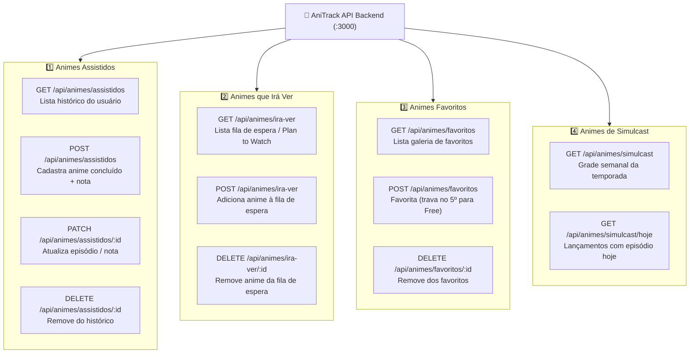
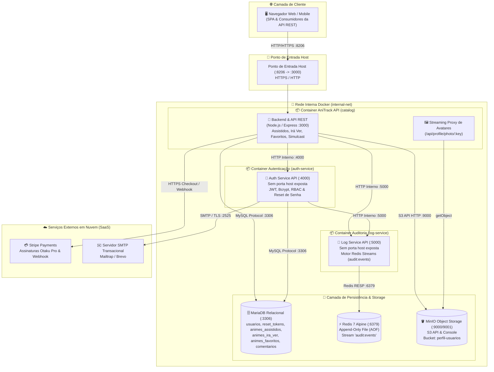

# 🌸 AniTrack — Plataforma & API SaaS de Gestão de Animes e Simulcast

> **Atividade Prática:** Evolução de Arquitetura em Microsserviços e SaaS em Nuvem  
> **Repositório:** Animes-API (Substituição e Evolução do Catálogo Original)

---

## 1. Nome e Frase

- **Nome do Produto:** **AniTrack** (ou **AniTrack API & SaaS**)
- **Frase de Uma Linha:** *O AniTrack é uma plataforma e API SaaS completa para gerenciar animes assistidos, planejar animes que irá ver, favoritar títulos marcantes e acompanhar o calendário de lançamentos simulcast em tempo real para fãs e comunidades otaku.*

---

## 2. A Dor

- **Quem sofre:** Fãs, espectadores assíduos e membros de comunidades de animes (de 16 a 35 anos) que acompanham simultaneamente múltiplos animes sazonais a cada nova temporada (*seasonal simulcasts*), além de consumidores casuais que querem manter um registro confiável do que assistem.
- **Quando:** Semanalmente nos dias de transmissão simultânea (simulcast) e nos períodos de virada de temporada (inverno, primavera, verão e outono), ao tentar lembrar em qual episódio parou, quais obras estreiam em cada dia da semana e quais títulos ainda estão na fila de espera.
- **Quanto custa hoje:**
  - **Dinheiro:** Gasto acumulado com múltiplos serviços de streaming sem saber com antecedência em qual plataforma ou dia da semana o anime é exibido, além de assinaturas de aplicativos de terceiros repletos de anúncios invasivos.
  - **Tempo:** Perda estimada de 30 a 50 minutos semanais navegando entre múltiplos sites, redes sociais, notas de celular e fóruns em busca de datas de transmissão, numeração de episódios e listas de obras.
  - **Risco:** Alto risco de receber *spoilers* em redes sociais (TikTok, X/Twitter, Instagram) por perder o dia da transmissão do episódio; abandono involuntário de bons animes por esquecer em qual temporada ou episódio parou; e perda irremediável de histórico de anos ao trocar de smartphone ou apagar anotações não centralizadas.
- **Como essa pessoa resolve hoje:** Faz anotações desestruturadas no bloco de notas do celular, manda mensagens para si mesma em conversas do WhatsApp, mantém planilhas manuais no Excel/Google Sheets (que exigem preenchimento manual cansativo e não possuem integração de dados) ou recorre a plataformas legadas (como MyAnimeList), que possuem interfaces pesadas, defasadas, cheias de banners publicitários e com experiência mobile ruim.

---

## 3. Persona

- **Nome fictício:** Lucas "Kuro" Silveira
- **Idade:** 23 anos
- **Rotina:** Estudante do último ano de Ciência da Computação e estagiário de desenvolvimento web. Seu dia a dia é corrido entre faculdade pela manhã e estágio à tarde. Nas noites e fins de semana, seu principal momento de lazer e descompressão é assistir a animes, acompanhar estreias da temporada e interagir com amigos em servidores do Discord.
- **O que tenta fazer:**
  - Acompanhar de 6 a 10 animes semanais em exibição simultânea (*simulcast*) durante a temporada atual;
  - Catalogar todos os animes que já assistiu ao longo dos anos para saber sua contagem de episódios e recomendar títulos a amigos;
  - Manter uma fila organizada de animes que planeja assistir (*plan to watch / irá ver*) nas férias da faculdade;
  - Destacar seus animes favoritos de todos os tempos em seu perfil para compartilhar com a comunidade.
- **O que atrapalha:** Falta de tempo e dispersão de informações. Como consome conteúdo em diferentes aparelhos (computador, smartphone e smart TV), ele constantemente esquece em qual episódio de qual anime parou. Não sabe com clareza quais animes novos estreiam na terça, na quinta ou no domingo, acabando por atrasar episódios e levando spoilers nas redes sociais. Além disso, recusa-se a atualizar planilhas manuais demoradas e se incomoda com a lentidão e excesso de propaganda de sites legados.

---

## 4. Concorrentes e Alternativas

| Concorrente / Alternativa | Como opera hoje | O que faz mal |
| :--- | :--- | :--- |
| **1. MyAnimeList (MAL) & AniList** | Plataformas web e apps de banco de dados e listas de anime de alcance global. | Interface visualmente sobrecarregada, navegação móvel engessada e excesso de anúncios invasivos (no MAL). O acompanhamento de *simulcast* em tempo real por dia da semana é confuso ou exige extensões de terceiros. Além disso, as APIs públicas são burocráticas e pouco amigáveis para integração direta. |
| **2. Planilhas Manuais (Google Sheets / Excel) & Notion** | Documentos pessoais preenchidos manualmente pelo usuário para rastrear animes. | Exige esforço 100% manual e repetitivo. Não possui conexão com bancos de dados de anime em tempo real: zero automação para atualizar status de episódios, ausência de capas, sinopses e datas oficiais de exibição, além de ser inviável para descobrir novos lançamentos de simulcast. |
| **3. Grupos de WhatsApp / Telegram & Redes Sociais** | Uso de mensagens fixadas, chats em grupo ou anotações em blocos de notas do celular. | Estrutura totalmente caótica e volátil. Mensagens importantes somem no fluxo de conversas; não existe ordenação, filtragem por gênero, status ou busca indexada; e expõe o usuário a spoilers constantes postados por outros participantes. |

---

## 5. Proposta de Valor

> **"O AniTrack elimina a desorganização e os spoilers ao reunir, em uma única plataforma rápida, moderna e sem poluição, o controle de animes assistidos, a fila de obras que irá ver, os favoritos e o calendário dinâmico de lançamentos simulcast da temporada em tempo real."**

---

## 6. Modelo de Receita com Stripe

O **AniTrack** adota o modelo **Freemium**, combinando uma camada de entrada gratuita com uma assinatura recorrente de baixo atrito monetizada através do **Stripe Billing & Checkout**:

### Comparativo de Planos

| Recurso / Benefício | Plano Free (Gratuito) | Plano Otaku Pro (Assinatura) |
| :--- | :---: | :---: |
| **Mensalidade** | **R$ 0,00 / mês** | **R$ 12,90 / mês** *(via Stripe)* |
| **Animes Assistidos** | Até 15 animes registrados | **Ilimitado** (histórico e estatísticas) |
| **Animes que Irá Ver** | Até 10 animes na fila de espera | **Ilimitado** (planejamento irrestrito) |
| **Animes Favoritos** | Até 5 títulos destacados | **Ilimitado** com ordenação personalizada |
| **Catálogo & Simulcast** | Grade básica da temporada | Grade completa com filtro por dia da semana |
| **Upload de Avatar (MinIO S3)** | Apenas imagem padrão | **Upload de fotos e banners customizados em HD** |
| **Presença na Comunidade** | Comentários normais | **Badge VIP Dourada ⭐ Otaku Pro** |
| **Experiência de Uso** | Limites por conta | **Sem travas e suporte prioritário** |

### O que o Plano Free limita:
O plano Free foi desenhado para atuar como funil de experimentação: permite cadastrar no máximo 15 animes assistidos, 10 animes na lista de "irá ver" e 5 favoritos, mantendo o avatar com foto padrão. Ao atingir o 16º anime assistido, 11º anime na fila ou 6º favorito, o sistema intercepta a ação com `HTTP 403 Forbidden` (`code: PREMIUM_REQUIRED`) e abre a oferta de upgrade para o plano Pro.

### Por que alguém pagaria o Pro?
Um fã de anime ativo consome entre 10 e 20 séries por ano e acompanha de 4 a 8 animes por trimestre de temporada (*Winter, Spring, Summer, Fall*). O teto de 15 títulos do Free é facilmente superado no primeiro mês. Por apenas **R$ 12,90/mês** (um valor acessível, equivalente a um café ou lanche rápido), o usuário:
1. Elimina para sempre qualquer barreira de limite de animes assistidos, pendentes e favoritos;
2. Conquista liberdade de customização enviando sua foto de perfil preferida via MinIO;
3. Ganha visibilidade e prestígio na comunidade com o selo dourado nos comentários;
4. Monitora a temporada inteira de simulcast com filtros inteligentes e visão por dia da semana.

---

## 7. Métricas de Sucesso

O sucesso e a saúde financeira do negócio são acompanhados através de quatro indicadores fundamentais:

1. **Assinantes Ativos (Paying Subscribers):**
   - Quantidade total líquida de usuários no plano *Otaku Pro*. Meta inicial: atingir **250 assinantes pagos** nos primeiros 6 meses após o lançamento.
2. **MRR (Monthly Recurring Revenue - Receita Recorrente Mensal):**
   - Receita líquida previsível mensal faturada através da Stripe. Com a meta de 250 assinantes a R$ 12,90/mês, projeta-se um MRR de **R$ 3.225,00/mês** no primeiro semestre.
3. **Retenção & Churn Rate:**
   - Meta de retenção mensal de assinantes superior a **85%** (mantendo o *Churn Rate* abaixo de **15%**). A alta retenção é impulsionada pela renovação trimestral das temporadas de anime no Japão, criando um hábito contínuo de consumo e checagem do simulcast semana a semana.
4. **Taxa de Conversão Free -> Pro (Conversion Rate):**
   - Percentual de novos cadastros gratuitos que se convertem em clientes pagantes ao atingirem os limites de catálogo. Meta estabelecida entre **5% e 8%** da base ativa.

---

## 8. Lean Canvas

Tabela executiva com os **9 blocos de Ash Maurya** preenchida para a plataforma **AniTrack**:

| Bloco | Pergunta que ele responde | Resposta para o AniTrack |
| :--- | :--- | :--- |
| **Problema** | Quais são as 1 a 3 dores principais? Como elas são resolvidas hoje? | 1. Dificuldade de acompanhar dias e horários exatos de animes em simulcast da temporada sem tomar spoilers.<br>2. Desorganização entre animes já vistos, fila de futuras obras e títulos favoritos.<br>3. Alternativas atuais são lentas, poluídas por anúncios excessivos ou dependem de anotações manuais precárias em blocos de notas/planilhas. |
| **Segmentos de clientes** | Quem sente a dor? Quem são os primeiros que adotariam o produto? | **Público Principal:** Jovens e adultos de 16 a 35 anos, fãs e espectadores de animes e cultura pop japonesa.<br>**Early Adopters:** Universitários e jovens profissionais que acompanham semanalmente estreias de simulcast, participam ativamente de servidores do Discord, Reddit e canais de streaming. |
| **Proposta única de valor** | Numa frase, por que escolher o seu produto e não as alternativas? | **Sua jornada otaku centralizada em um só lugar:** controle animes assistidos, planeje o que vai ver, destaque favoritos e acompanhe lançamentos semanais de simulcast em uma plataforma rápida, limpa e moderna. |
| **Solução** | As 3 funcionalidades que atacam cada dor, nem uma a mais. | 1. **Gestão Dinâmica de 3 Listas:** Marcação com um clique de animes *Assistidos*, lista *Irá Ver* e *Favoritos* com contador de episódios.<br>2. **Feed Dinâmico de Simulcast:** Calendário da temporada atual com lançamentos semanais organizados por dia de exibição.<br>3. **Perfil Social com Mídia:** Upload de avatares de alta qualidade via MinIO S3 e comentários comunitários por anime. |
| **Canais** | Como o cliente fica sabendo do produto e chega até ele? | - Divulgação em comunidades focadas no Discord e subreddits (r/animebrasil, r/anime).<br>- Conteúdos em redes sociais (TikTok, Reels e X/Twitter) com guias e destaques da temporada de simulcast.<br>- Boca a boca orgânico entre estudantes e grupos de amigos universitários.<br>- Documentação aberta e interativa da API REST para a comunidade técnica. |
| **Fontes de receita** | Quem paga, quanto e como: os planos do Stripe. | - **Plano Free (R$ 0,00):** Gratuito com travas de capacidade (15 assistidos, 10 irá ver, 5 favoritos).<br>- **Plano Otaku Pro (R$ 12,90/mês):** Cobrança recorrente automatizada via cartão de crédito no **Stripe Checkout**, liberando capacidade ilimitada, upload de avatares e selo VIP. |
| **Estrutura de custos** | O que custa pra manter no ar: infraestrutura, taxas do Stripe, tempo. | - Servidor VPS / Host IaaS para containers Docker (backend, auth-service, log-service, MariaDB, Redis, MinIO).<br>- Taxas transacionais de processamento da Stripe (3,99% + R$ 0,39 por transação aprovada).<br>- Tráfego de dados e armazenamento de mídia (MinIO Object Storage).<br>- Custos de domínio DNS e manutenção de software. |
| **Métricas-chave** | Os números que você acompanha: cadastros, assinantes, MRR, retenção. | - Usuários Ativos Mensais (MAU) e Semanais (WAU).<br>- Taxa de Conversão de Free para Pro (meta 5%–8%).<br>- Receita Recorrente Mensal (MRR).<br>- Taxa de Retenção e Churn Rate (< 15%).<br>- Volume total de animes catalogados pelos usuários. |
| **Vantagem injusta** | O que não dá pra copiar fácil: acesso a um público, conhecimento, dados. | - Arquitetura modular resiliente em microsserviços ultrarrápidos com ingestão em Redis Streams, entregando tempos de resposta instantâneos.<br>- Foco direto na experiência limpa e fluida do público brasileiro, sem poluição de banners de anúncios.<br>- Histórico enriquecido e categorizado por temporadas oficiais japonesas. |

---

## Reaproveitamento

### O que cada peça atual vira no SaaS
Nada da arquitetura vai pro lixo: cada serviço que você construiu ganha um papel no negócio novo.

| Peça do projeto atual | O que vira no SaaS | Exemplo no AniTrack (Novo Negócio) |
| :--- | :--- | :--- |
| **Catálogo de filmes (TMDB)** | **Catálogo de Animes & Simulcast** (Recurso principal do negócio) | Gerenciamento integral do domínio: listagem de animes em **Simulcast da temporada**, controle de títulos **Assistidos**, fila de espera de obras que **Irá Ver** e galeria de **Favoritos** com progresso de episódios. |
| **Microsserviço de login + RBAC** | **Gestão de Identidade, Perfis e Papéis de Negócio** | Autenticação por token JWT, recuperação de senhas por e-mail via SMTP e controle de acessos RBAC: papel `usuario` (otaku que administra suas próprias listas) e papel `admin` (moderação de comentários comunitários e curadoria do acervo). |
| **Logs e auditoria (Redis)** | **Trilha de Eventos de Negócio & Auditoria Comportamental** | Registro imutável de eventos comportamentais em Redis Streams (`audit:events`): `"anime_marcado_assistido"`, `"anime_adicionado_ira_ver"`, `"anime_favoritado"`, `"comentario_postado"`, `"upgrade_otaku_pro"`, `"tentativa_acesso_negada"`. |
| **Upload e perfil (MinIO)** | **Arquivos do Domínio & Mídia dos Usuários** | Armazenamento de alta performance no Object Storage S3 (bucket `perfil-usuarios`) para avatares customizados e banners dos assinantes Pro, com validação de segurança de Magic Bytes contra arquivos maliciosos. |
| **Plano Premium (Stripe)** | **Assinatura Recorrente Otaku Pro** | Motor de monetização via Stripe Checkout e Webhooks assíncronos: remove travas de limites nas listas de assistidos, fila e favoritos, libera upload de avatares no MinIO e adiciona a badge VIP dourada. |
| **Swagger, CI/CD, observabilidade** | **Governança Técnica & Documentação da API de Animes** | Documentação OpenAPI interativa de todos os endpoints de animes, pipeline de testes/deploy contínuo em containers Docker e observabilidade em rede isolada. |

---

## ⛩️ Detalhamento das Requisições da API de Animes

O AniTrack atende integralmente às quatro requisições funcionais da aplicação:



### 1. Animes Assistidos (`/api/animes/assistidos`)
- **Finalidade:** Manter o histórico de obras concluídas ou em progresso, registrando quantidade de episódios vistos e nota pessoal.
- **Regra Freemium:** Usuários Free registram até **15 animes**. Assinantes Pro têm registros **ilimitados**.
- **Endpoints:**
  - `GET /api/animes/assistidos`: Retorna animes assistidos do usuário autenticado.
  - `POST /api/animes/assistidos`: Cadastra um anime no histórico (`anime_id`, `titulo`, `poster_url`, `episodios_vistos`, `total_episodios`, `nota`). Emite o evento `anime_marcado_assistido` no Redis Streams.
  - `PATCH /api/animes/assistidos/:id`: Atualiza número de episódios assistidos e nota.
  - `DELETE /api/animes/assistidos/:id`: Remove do histórico.

### 2. Animes que Irá Ver (`/api/animes/ira-ver`)
- **Finalidade:** Organizar a fila de planejamento (*watchlist / plan to watch*) para futuras temporadas e férias.
- **Regra Freemium:** Usuários Free salvam até **10 animes** na fila. Assinantes Pro possuem fila **ilimitada**.
- **Endpoints:**
  - `GET /api/animes/ira-ver`: Lista todos os animes pendentes na fila.
  - `POST /api/animes/ira-ver`: Adiciona novo título à fila (`anime_id`, `titulo`, `poster_url`, `previsao_estreia`). Emite evento `anime_adicionado_ira_ver` no Redis Streams.
  - `DELETE /api/animes/ira-ver/:id`: Remove título da fila de espera.

### 3. Animes Favoritos (`/api/animes/favoritos`)
- **Finalidade:** Destacar os animes preferidos do usuário no perfil comunitário.
- **Regra Freemium:** Usuários Free salvam até **5 favoritos**. Assinantes Pro têm favoritos **ilimitados**.
- **Endpoints:**
  - `GET /api/animes/favoritos`: Retorna os favoritos do usuário autenticado.
  - `POST /api/animes/favoritos`: Adiciona anime aos favoritos. Caso o usuário Free tente salvar o 6º favorito, retorna `HTTP 403 Forbidden` (`code: PREMIUM_REQUIRED`). Assinantes Pro salvam sem limite e emitem o evento `anime_favoritado` no Redis.
  - `DELETE /api/animes/favoritos/:id`: Remove o anime dos favoritos.

### 4. Animes de Simulcast (`/api/animes/simulcast`)
- **Finalidade:** Rastrear a grade de transmissão simultânea japonesa da temporada atual com datas e dias da semana.
- **Endpoints:**
  - `GET /api/animes/simulcast`: Retorna todas as obras da temporada agrupadas por dia da semana (segunda a domingo).
  - `GET /api/animes/simulcast/hoje`: Retorna apenas os episódios que vão ao ar na data atual do servidor.

---

## 🏛️ Arquitetura de Microsserviços & Isolamento de Rede

A solução mantém o rigor técnico de microsserviços em rede interna isolada:



---

## 🗄️ Modelo de Dados Relacional (MariaDB)

```sql
-- Gerenciadas pelo Auth-Service / Backend:
CREATE TABLE IF NOT EXISTS usuarios (
  id INT AUTO_INCREMENT PRIMARY KEY,
  nome VARCHAR(100) NOT NULL,
  email VARCHAR(150) UNIQUE NOT NULL,
  senha_hash VARCHAR(255) NOT NULL,
  role VARCHAR(20) NOT NULL DEFAULT 'usuario',
  bio VARCHAR(500) DEFAULT '',
  foto_perfil VARCHAR(255) DEFAULT NULL,
  is_premium BOOLEAN DEFAULT FALSE,
  stripe_customer_id VARCHAR(255) DEFAULT NULL,
  stripe_subscription_id VARCHAR(255) DEFAULT NULL,
  criado_em TIMESTAMP DEFAULT CURRENT_TIMESTAMP
) ENGINE=InnoDB DEFAULT CHARSET=utf8mb4;

CREATE TABLE IF NOT EXISTS reset_tokens (
  id INT AUTO_INCREMENT PRIMARY KEY,
  token VARCHAR(255) UNIQUE NOT NULL,
  usuario_id INT NOT NULL,
  criado_em TIMESTAMP DEFAULT CURRENT_TIMESTAMP,
  expira_em DATETIME NOT NULL,
  usado BOOLEAN DEFAULT FALSE,
  FOREIGN KEY (usuario_id) REFERENCES usuarios(id) ON DELETE CASCADE
) ENGINE=InnoDB DEFAULT CHARSET=utf8mb4;

-- Gerenciadas pelo AniTrack Backend:
CREATE TABLE IF NOT EXISTS animes_assistidos (
  id INT AUTO_INCREMENT PRIMARY KEY,
  usuario_id INT NOT NULL,
  anime_id INT NOT NULL,
  titulo VARCHAR(255) NOT NULL,
  poster_url VARCHAR(255),
  episodios_vistos INT DEFAULT 0,
  total_episodios INT DEFAULT 12,
  nota INT DEFAULT NULL,
  status VARCHAR(50) DEFAULT 'concluido',
  criado_em TIMESTAMP DEFAULT CURRENT_TIMESTAMP,
  FOREIGN KEY (usuario_id) REFERENCES usuarios(id) ON DELETE CASCADE,
  UNIQUE KEY uq_usuario_assistido (usuario_id, anime_id)
) ENGINE=InnoDB DEFAULT CHARSET=utf8mb4;

CREATE TABLE IF NOT EXISTS animes_ira_ver (
  id INT AUTO_INCREMENT PRIMARY KEY,
  usuario_id INT NOT NULL,
  anime_id INT NOT NULL,
  titulo VARCHAR(255) NOT NULL,
  poster_url VARCHAR(255),
  previsao_estreia VARCHAR(100),
  criado_em TIMESTAMP DEFAULT CURRENT_TIMESTAMP,
  FOREIGN KEY (usuario_id) REFERENCES usuarios(id) ON DELETE CASCADE,
  UNIQUE KEY uq_usuario_ira_ver (usuario_id, anime_id)
) ENGINE=InnoDB DEFAULT CHARSET=utf8mb4;

CREATE TABLE IF NOT EXISTS animes_favoritos (
  id INT AUTO_INCREMENT PRIMARY KEY,
  usuario_id INT NOT NULL,
  anime_id INT NOT NULL,
  titulo VARCHAR(255) NOT NULL,
  poster_url VARCHAR(255),
  criado_em TIMESTAMP DEFAULT CURRENT_TIMESTAMP,
  FOREIGN KEY (usuario_id) REFERENCES usuarios(id) ON DELETE CASCADE,
  UNIQUE KEY uq_usuario_favorito (usuario_id, anime_id)
) ENGINE=InnoDB DEFAULT CHARSET=utf8mb4;

CREATE TABLE IF NOT EXISTS comentarios (
  id INT AUTO_INCREMENT PRIMARY KEY,
  usuario_id INT NOT NULL,
  anime_id INT NOT NULL,
  texto TEXT NOT NULL,
  criado_em TIMESTAMP DEFAULT CURRENT_TIMESTAMP,
  FOREIGN KEY (usuario_id) REFERENCES usuarios(id) ON DELETE CASCADE
) ENGINE=InnoDB DEFAULT CHARSET=utf8mb4;
```

---

## 🚀 Como Executar o Projeto Localmente

### 1. Arquivos de Configuração
Consulte o arquivo [`docker-compose.yml`](file:///C:/Users/shida/OneDrive/Documentos/animes/Animes-API/docker-compose.yml) e copie as configurações do arquivo de exemplo:
```bash
cp .env.example .env
```

### 2. Configurar as Variáveis de Ambiente
Verifique o arquivo [`.env.example`](file:///C:/Users/shida/OneDrive/Documentos/animes/Animes-API/.env.example) e preencha as variáveis de banco de dados, JWT, MinIO e Stripe:
```env
# Banco de Dados MariaDB
DB_HOST=mariadb
DB_PORT=3306
DB_USER=root
DB_PASSWORD=rootpassword
DB_NAME=catalogofilmes

# JWT & Segurança
JWT_SECRET=sua_chave_jwt_secreta

# Stripe (Modo de Teste)
STRIPE_SECRET_KEY=sk_test_...
STRIPE_PRICE_ID=price_...
STRIPE_WEBHOOK_SECRET=whsec_...

# MinIO (Object Storage S3)
MINIO_ACCESS_KEY=minioadmin
MINIO_SECRET_KEY=minioadmin
MINIO_BUCKET=perfil-usuarios
```

### 3. Subir os Containers
Na pasta raiz do projeto, execute:
```bash
docker compose up --build -d
```

### 4. Acesso aos Serviços
- **AniTrack Web & API:** [http://localhost:8206](http://localhost:8206) (ou porta mapeada no host)
- **MinIO Console (S3):** [http://localhost:9001](http://localhost:9001) (`minioadmin` / `minioadmin`)
