# 🎬 Catálogo de Filmes, Microsserviço de Autenticação & Auditoria (Redis Streams) — Tom Hanks

> Atividade Prática da disciplina **ISW055 - Introdução à Computação em Nuvem**  
> Professor: **Allan Siriani** ([@siriani](https://github.com/siriani))

---

## 📑 Documentação & Relatório da Avaliação (P1)

- 🌐 **Projeto Typst (Online):** [https://typst.app/project/rX3EbzDLLDhKvviFphLnxH](https://typst.app/project/rX3EbzDLLDhKvviFphLnxH)
- 📄 **Relatório em PDF:** [docs/P1.pdf](docs/P1.pdf)
- 📁 **Pasta de Documentos & Evidências:** [docs/](docs/)

---

## 📌 Sobre o Projeto

Aplicação web estruturada em **Arquitetura de Microsserviços** para exibição e gerenciamento da filmografia do ator **Tom Hanks**, integrando consumo de dados em tempo real da **TMDB (The Movie Database)**, persistência no **MariaDB** com segregação por usuário, um **serviço isolado de autenticação** com gerenciamento de papéis (*roles*), recuperação de senhas por e-mail com expiração real, um **serviço isolado de logs e auditoria (`log-service`)** com persistência em **Redis Streams** (`audit:events`), armazenamento de fotos de perfil no **MinIO (Object Storage S3)**, e fluxo de monetização e assinaturas recorrentes com **Stripe Checkout & Webhooks** para liberação do **Plano Premium** com favoritos ilimitados.

---

## 📋 Documentação Reversa do Sistema & Classificação em Nuvem

Esta seção consolida a **documentação reversa integral** do sistema, gerada a partir da inspeção minuciosa do código-fonte, dos microsserviços e das integrações em nuvem.

### 1. Classificação SaaS / PaaS / IaaS do Projeto

Tabela classificatória com cada peça do sistema final, indicando a camada do modelo de serviço em computação em nuvem e a justificativa técnica:

| Componente / Peça do Sistema | Camada de Serviço | Justificativa Técnica |
| :--- | :---: | :--- |
| **Máquina Virtual (Host / Servidor VPS / Portainer VM)** | **IaaS** *(Infrastructure as a Service)* | Fornece os recursos brutos de hardware virtualizado (CPU, memória RAM, interfaces de rede e disco rígido virtual), ficando a cargo do operador o provisionamento do sistema operacional Linux, patches de segurança e runtime de virtualização. |
| **Containers Docker / Docker Compose / Portainer CaaS** | **PaaS** *(Platform as a Service)* / **CaaS** *(Containers as a Service)* | Fornece a plataforma padronizada e isolada para execução das aplicações e microsserviços, abstraindo configurações do kernel do host e gerenciando ciclo de vida, resolução de DNS interna e pontes de rede (`internal-net`). |
| **Stripe (Checkout, Billing & Webhooks)** | **SaaS** *(Software as a Service)* | Solução completa de processamento de pagamentos e assinaturas recorrentes hospedada na nuvem da Stripe, consumida como software pronto via chamadas de API HTTPS e disparos de Webhook sem necessidade de manter infraestrutura financeira. |
| **Serviço de E-mail SMTP (Mailtrap / Brevo)** | **SaaS** *(Software as a Service)* | Plataforma em nuvem gerenciada para envio e entrega de e-mails transacionais (redefinição de senha), consumida via protocolo SMTP padronizado sem demandar servidor local de e-mails (como Postfix/Sendmail). |
| **API The Movie Database (TMDB)** | **SaaS** *(Software as a Service)* | Serviço externo em nuvem que fornece dados catalogados, sinopses, avaliações e pôsteres de filmes em tempo real via API REST JSON, eliminando a necessidade de coletar e manter uma base própria de dados cinematográficos. |
| **Banco de Dados Relacional (MariaDB)** | **PaaS** *(DBaaS)* / **PaaS Local** | Plataforma de banco de dados relacional transacional (ACID) que provê persistência de tabelas estruturadas, integridade referencial com chaves estrangeiras e pool de conexões otimizado para as regras de negócio da aplicação. |
| **Object Storage (MinIO S3-Compatible)** | **PaaS** *(Storage as a Service)* | Plataforma dedicada de armazenamento de objetos binários não estruturados (avatares de perfil), disponibilizando interface compatível com AWS S3, políticas de bucket e streaming proxy, evitando a poluição da base relacional com BLOBs. |
| **Armazenamento em Memória / Streams (Redis)** | **PaaS** *(In-Memory Data Store as a Service)* | Plataforma de dados em memória de alta performance configurada com durabilidade AOF, utilizada como message/event store com a estrutura Redis Streams para ingestão e consulta ordenada de logs de auditoria. |

---

### 2. Documentação Reversa — Especificação Funcional (Ponto de Vista do Usuário)

> *Visão Funcional: O que o sistema faz na prática para o usuário final e administrador (escrito na perspectiva de quem assumiu a sustentação e evolução desta base de código).*

O sistema é uma aplicação web completa voltada para os entusiastas da filmografia do ator **Tom Hanks**, operando no modelo *Freemium* com recursos colaborativos e área administrativa. A jornada do usuário abrange os seguintes pilares funcionais:

1. **Acesso, Identificação e Sessão (Cadastro, Login e Logout):**
   - O visitante realiza cadastro fornecendo Nome, E-mail e Senha (com validação mínima de 4 caracteres), além de definir seu papel inicial (`usuario` ou `admin` para fins didáticos da disciplina).
   - Ao se autenticar com e-mail e senha, o sistema valida a integridade com hash criptográfico `bcrypt` e gera uma credencial de acesso segura (**JWT — JSON Web Token**).
   - A sessão do usuário fica persistida em cookie `httpOnly` e no cabeçalho HTTP de requisições subsequentes por 7 dias. Ao clicar em *"Sair"*, a sessão é invalidada imediatamente e o evento de encerramento é auditado.

2. **Fluxo de Auto-Recuperação de Acesso ("Esqueci Minha Senha"):**
   - Caso o usuário esqueça sua senha, ele pode clicar em *"Esqueceu a senha?"* na tela de autenticação e digitar o e-mail da conta.
   - O sistema gera um token criptográfico pseudoaleatório de alta entropia (32 bytes em formato hexadecimal) com **validade estrita de 30 minutos** e dispara um e-mail transacional formatado via SMTP (Mailtrap em homologação / Brevo em produção) contendo um link exclusivo (`/?reset_token=...`).
   - Ao acessar o link pelo e-mail, a aplicação confere a validade e o estado do token (não usado e não expirado) e libera a tela de cadastro da nova senha. Uma vez redefinida, o token é marcado como utilizado, prevenindo reuso malicioso.

3. **Catálogo Dinâmico e Filmografia Tom Hanks:**
   - Ao acessar a tela principal, o usuário visualiza uma galeria em grade com todos os filmes de Tom Hanks obtidos em tempo real da API do The Movie Database (TMDB).
   - A interface permite filtrar por **"Todos os Filmes"** ou **"Meus Favoritos"**, aplicar busca textual dinâmica em tempo real pelo título do filme e ordenar por Ano de Lançamento (mais recente ou antigo), Avaliação da Crítica (maior ou menor nota) ou Título (A-Z ou Z-A).
   - Cada card do catálogo exibe o pôster oficial, ano de lançamento, nota média em estrelas, sinopse resumida, ícone interativo de favorito e contador em tempo real dos comentários da comunidade.

4. **Gerenciamento de Favoritos e Isolamento por Conta:**
   - O usuário pode favoritar ou desfavoritar qualquer título clicando no ícone de estrela.
   - Cada usuário possui sua própria lista isolada no banco de dados; as preferências de um usuário não interferem nem são visíveis nas listas privadas de outros usuários.
   - No **Plano Gratuito**, o usuário pode salvar até **5 filmes favoritos**. Ao tentar favoritar o sexto filme, a aplicação intercepta a ação e exibe o modal de upgrade para o Plano Premium.

5. **Interação Social da Comunidade (Comentários):**
   - Ao clicar no botão de comentários de um filme, é aberto um modal com a sinopse detalhada e a lista cronológica de mensagens postadas pela comunidade.
   - Usuários autenticados podem postar comentários sobre os filmes. Cada comentário exibe o nome do autor, sua foto de perfil personalizada (avatar) e, se o autor for assinante, a insígnia dourada **`⭐ PREMIUM`**.
   - **Autorregulação:** O usuário tem direito de apagar os próprios comentários que tiver escrito a qualquer momento.

6. **Moderação de Conteúdo para Administradores:**
   - Usuários com o papel de Administrador (`admin`) recebem controles estendidos na interface: visualizam o botão de lixeira em **todos** os comentários do sistema, podendo apagar intervenções inadequadas de terceiros de forma sumária (ação de moderação protegida por RBAC).

7. **Perfil de Usuário e Personalização:**
   - O usuário pode abrir seu modal de perfil clicando no cabeçalho da página. O perfil exibe: nome completo, endereço de e-mail, insígnia de papel (`[Usuário]` ou `[Admin]`), selo de plano (`[⭐ PREMIUM]`), data de criação da conta, biografia e a listagem pessoal dos seus filmes favoritos com quantidade de comentários.
   - O titular da conta pode editar seu nome e redigir uma biografia de até 500 caracteres, com contador de caracteres em tempo real.

8. **Upload de Foto de Perfil (Avatar com Object Storage):**
   - O usuário pode enviar uma foto de perfil diretamente do seu computador.
   - O arquivo passa por verificação de segurança binária (Magic Bytes) contra arquivos maliciosos e limite de 5 MB, sendo armazenado em nuvem no **MinIO (Object Storage S3)**.
   - A foto atualizada passa a ser exibida na barra de navegação, na página de perfil e ao lado de todos os comentários feitos pelo usuário na comunidade.

9. **Assinatura Recorrente do Plano Premium (Stripe):**
   - O usuário pode clicar em *"⭐ Seja Premium"* no topo do site para visualizar a proposta de valor por **R$ 9,90/mês**: favoritos ilimitados (fim da trava de 5 filmes), selo dourado VIP em toda a plataforma e suporte com ativação imediata.
   - Clicando em *"Assinar Premium"*, o sistema cria uma sessão segura de checkout na Stripe e redireciona o usuário para a página de pagamento oficial da Stripe.
   - Após a liquidação do pagamento (mesmo em modo de teste), a Stripe notifica o backend via Webhook autenticado criptograficamente, a conta do usuário é promovida para `is_premium = true` e o catálogo libera capacidade ilimitada de favoritos instantaneamente.
   - Se a assinatura for cancelada ou não for renovada na Stripe, o sistema rebaixa a conta de volta para o plano gratuito sem perda dos dados cadastrais.

10. **Trilha de Auditoria e Governança (Exclusiva para Administradores):**
    - Administradores têm acesso ao histórico cronológico imutável de eventos comportamentais e de segurança armazenados no Redis Streams (`audit:events`), auditando quem fez login/logout, quem favoritou ou desfavoritou filmes, quem comentou, quem executou moderação de terceiros e quais requisições foram bloqueadas por falta de permissão (erros 403 Forbidden).

---

### 3. Documentação Reversa — Arquitetura de Microsserviços ("The Big Picture")

O diagrama abaixo detalha a visão arquitetural completa de todos os microsserviços, componentes de infraestrutura, bancos de dados e integrações de nuvem externas, mapeando portas, protocolos e canais de comunicação:

```mermaid
flowchart TD
    subgraph CLIENTE["🌐 Camada de Cliente (Navegador Web)"]
        Browser["🖥️ Usuário / Navegador Web\n(HTML5, CSS3 Moderno, JavaScript ES Modules)"]
    end

    subgraph INGRESS["🚪 Ponto de Entrada Público (Host)"]
        PortaPublica["Ponto de Entrada Host (:8206 -> :3000)\nHTTPS / HTTP"]
    end

    subgraph DOCKER_NET["🐳 Rede Interna Docker (internal-net / bridge)"]
        subgraph CATALOG_CONTAINER["📦 Container Catálogo de Filmes (catalog)"]
            CatalogApp["🚀 Catálogo Web & API Backend\n(Node.js / Express :3000)"]
            StaticFiles["📁 Frontend Estático (SPA)\n(/frontend/index.html, js, css)"]
            ProxyPhoto["🖼️ Streaming Proxy de Fotos\n(GET /api/profile/photo/:key)"]
        end

        subgraph AUTH_CONTAINER["📦 Container Microsserviço de Autenticação (auth-service)"]
            AuthApp["🔐 Auth Service API\n(Node.js / Express :4000)\nSem porta host exposta"]
            JWTModule["🔑 Emissor / Validador JWT & Bcrypt"]
            RBACModule["🛡️ Matriz de Permissões RBAC\n(Padrão A Centralizado)"]
        end

        subgraph LOG_CONTAINER["📦 Container Microsserviço de Auditoria (log-service)"]
            LogApp["📜 Log Service API\n(Node.js / Express :5000)\nSem porta host exposta"]
            StreamEngine["⚡ Motor de Eventos Streams\n(XADD / XRANGE / XREVRANGE)"]
        end

        subgraph DATA_STORES["💾 Camada de Persistência & Armazenamento"]
            MariaDB[("🗄️ MariaDB Relacional (:3306)\nusuarios, reset_tokens,\nfavoritos, comentarios")]
            Redis[("⚡ Redis 7 Alpine (:6379)\nAppend-Only File (AOF)\nStream 'audit:events'")]
            MinIO[("🪣 MinIO Object Storage (:9000/9001)\nS3 API & Console\nBucket: perfil-usuarios")]
        end
    end

    subgraph EXTERNAL_SAAS["☁️ Serviços Externos em Nuvem (SaaS)"]
        TMDB["🎬 TMDB API (The Movie Database)\nhttps://api.themoviedb.org/3"]
        Stripe["💳 Stripe Payments & Checkout\nAPI HTTPS + Webhook Server-to-Server"]
        SMTP["✉️ Servidor SMTP Transacional\nMailtrap (dev) / Brevo (prod)"]
    end

    %% Conexões do Cliente
    Browser -->|HTTP/HTTPS :8206| PortaPublica
    PortaPublica --> CatalogApp
    CatalogApp -.-> StaticFiles

    %% Comunicação entre Serviços (Rede Interna)
    CatalogApp -->|HTTP POST /api/auth/*\nValidação RBAC & Tokens| AuthApp
    CatalogApp -->|HTTP POST /api/logs/events\nGET /api/logs (Admin)| LogApp
    AuthApp -->|HTTP POST /api/logs/events\nAuditoria login/logout/403| LogApp

    %% Acesso aos Bancos de Dados e Armazenamento
    CatalogApp -->|MySQL Protocol :3306\nfavoritos, comentarios, usuarios| MariaDB
    AuthApp -->|MySQL Protocol :3306\nusuarios, reset_tokens| MariaDB
    LogApp -->|Redis Protocol RESP :6379\nPersistência em Streams| Redis
    CatalogApp -->|S3 API HTTP :9000\nUpload e streaming de fotos| MinIO
    ProxyPhoto -->|getObject| MinIO

    %% Integrações Externas (SaaS)
    CatalogApp -->|HTTPS /api.themoviedb.org\nFilmografia Tom Hanks| TMDB
    CatalogApp -->|HTTPS /v1/checkout/sessions\nCriação de Checkout| Stripe
    Stripe -->|POST /api/stripe/webhook\nAssinatura stripe-signature| CatalogApp
    AuthApp -->|SMTP / TLS :2525 ou :587\nE-mail de Recuperação de Senha| SMTP
```

#### Detalhamento das Conexões Arquiteturais:
1. **Catálogo como Ponto Único de Entrada (*Single Public Ingress*):** Apenas o container `catalog` expõe porta para o host externo (`8206:3000`). Os containers `auth-service`, `log-service`, `redis` e `minio` ficam estritamente confinados à rede bridge `internal-net`, sem mapeamento de portas externas.
2. **Autenticação Desacoplada (`auth-service`):** O Catálogo delega o processamento de login, cadastro, emissão de tokens e checagem de permissões via requisições HTTP internas para `http://auth-service:4000`.
3. **Auditoria Assíncrona e Resiliente (`log-service`):** Catálogo e Auth-Service emitem eventos comportamentais em segundo plano (*fire-and-forget*) para `http://log-service:5000/api/logs/events`, gravados no stream `audit:events` do Redis. Caso o serviço de log falhe, a requisição do usuário não é interrompida.
4. **Isolamento de Dados Binários (MinIO):** Imagens binárias são transferidas via S3 SDK diretamente para o bucket `perfil-usuarios` do MinIO. O Catálogo provê um streaming proxy cacheável (`/api/profile/photo/*`), evitando que o navegador precise acessar a porta do MinIO diretamente.
5. **Integração de Pagamentos em Dois Sentidos (Stripe):** Comunicação síncrona para iniciar a sessão de checkout (`/v1/checkout/sessions`) e comunicação assíncrona orientada a eventos para ativação e cancelamento do plano premium via Webhook criptografado (`POST /api/stripe/webhook`).

---

### 4. Documentação Reversa — Regras de Negócio do Código ("Se X, então Y")

Abaixo estão listadas as regras de negócio efetivamente impostas pelo código-fonte dos microsserviços, agrupadas por domínio:

#### 🔐 4.1. Autenticação, Cadastro e Sessão
- **RN-01:** *Se* a requisição de cadastro (`POST /api/auth/register`) omitir `nome`, `email` ou `senha`, *então* o servidor rejeita a criação com `HTTP 400 Bad Request` ("Todos os campos são obrigatórios").
- **RN-02:** *Se* a senha informada no cadastro ou na redefinição possuir comprimento inferior a 4 caracteres, *então* o servidor rejeita a operação com `HTTP 400 Bad Request` ("A senha deve conter no mínimo 4 caracteres").
- **RN-03:** *Se* o e-mail informado no cadastro já existir na coluna `email` (única) da tabela `usuarios`, *então* a requisição é negada com `HTTP 409 Conflict` ("Este e-mail já está cadastrado").
- **RN-04:** *Se* o campo `role` enviado no cadastro for diferente de `'admin'`, *então* o sistema atribui compulsoriamente o papel padrão `'usuario'`.
- **RN-05:** *Se* as credenciais de login (`email` e `senha`) não corresponderem a um registro válido ou o hash `bcrypt.compare` falhar, *então* o servidor retorna `HTTP 401 Unauthorized` ("Credenciais inválidas").
- **RN-06:** *Se* o login for bem-sucedido, *então* o sistema emite um token JWT com segredo compartilhado, grava um cookie seguro `token` com validade de 7 dias e emite um evento de auditoria `login` no Redis Streams.
- **RN-07:** *Se* o usuário acionar o logout (`POST /api/auth/logout`), *então* o cookie de sessão é limpo no navegador e um evento `logout` é persistido na auditoria.

#### 🔑 4.2. Recuperação de Senha ("Esqueci Minha Senha")
- **RN-08:** *Se* o e-mail informado em `forgot-password` existir no banco, *então* o sistema gera um token criptográfico de 32 bytes (`crypto.randomBytes(32)`), registra na tabela `reset_tokens` com validade de exatamente 30 minutos (`expira_em = NOW() + 30 MINUTE`, `usado = FALSE`) e dispara e-mail com link de redefinição via SMTP.
- **RN-09:** *Se* o e-mail informado em `forgot-password` não existir, *então* o sistema retorna resposta genérica de sucesso sem erro (prevenção contra ataques de enumeração de e-mails de usuários).
- **RN-10:** *Se* o token informado na redefinição de senha não constar na tabela `reset_tokens`, *então* a operação falha com `HTTP 400 Bad Request` ("Token de recuperação inválido ou inexistente").
- **RN-11:** *Se* o token de redefinição já tiver o campo `usado == TRUE`, *então* o servidor recusa a tentativa com `HTTP 400 Bad Request` ("Este link de recuperação já foi utilizado").
- **RN-12:** *Se* o horário da submissão da nova senha for posterior a `expira_em` (`agora > expira_em`), *então* o servidor recusa a requisição com `HTTP 400 Bad Request` ("Este link de recuperação expirou (validade de 30 minutos ultrapassada)").
- **RN-13:** *Se* o token for válido, não usado e dentro dos 30 minutos, *então* o hash Bcrypt da nova senha é salvo no usuário e o token é marcado atomicamente como `usado = TRUE`.

#### ⭐ 4.3. Favoritos & Regra de Negócio Premium
- **RN-14:** *Se* um usuário comum (`is_premium == FALSE`) tentar favoritar um filme (`POST /api/favorites`) e sua contagem atual de favoritos for igual ou superior a 5 (`total >= 5`), *então* o sistema bloqueia o cadastro, retorna `HTTP 403 Forbidden` com código `PREMIUM_REQUIRED` e registra o evento `limite_favoritos_atingido` no Redis Streams.
- **RN-15:** *Se* o usuário for assinante (`is_premium == TRUE`), *então* a limitação de favoritos é ignorada, concedendo capacidade de favoritar filmes de forma ilimitada.
- **RN-16:** *Se* o usuário tentar favoritar um filme que já se encontra em seus favoritos, *então* o comando `ON DUPLICATE KEY UPDATE` atualiza título e pôster sem gerar erro nem criar registros duplicados.
- **RN-17:** *Se* um usuário remover um filme dos favoritos (`DELETE /api/favorites/:id`), *então* a remoção é executada estritamente onde `usuario_id = req.user.id` e o evento `desfavoritar_filme` é auditado.

#### 💬 4.4. Comentários e Moderação RBAC
- **RN-18:** *Se* o texto de um novo comentário (`POST /api/movies/:id/comments`) estiver vazio ou em branco, *então* o servidor retorna `HTTP 400 Bad Request` ("O texto do comentário não pode ser vazio").
- **RN-19:** *Se* o usuário tentar apagar um comentário (`DELETE /api/comments/:id`) e for o autor legítimo da postagem (`comentario.usuario_id === req.user.id`), *então* a exclusão é autorizada com base na permissão `comentarios:excluir_proprio` e o evento `apagar_comentario` é auditado.
- **RN-20:** *Se* o usuário tentar apagar um comentário cujo autor seja outro usuário (`comentario.usuario_id !== req.user.id`):
  - *Se* o usuário autenticado tiver o papel `usuario`, *então* a autorização é negada com `HTTP 403 Forbidden`, o comentário permanece intacto e o evento `permissao_negada` é auditado no Redis.
  - *Se* o usuário autenticado tiver o papel `admin`, *então* a ação é aprovada sob a permissão `comentarios:excluir_qualquer`, o comentário é excluído e o evento `apagar_comentario_moderacao` é gravado.

#### 👤 4.5. Perfil de Usuário & Defesa contra IDOR
- **RN-21:** *Se* na rota de atualização de perfil (`PUT /api/profile`) ou upload de foto (`POST /api/profile/photo`) for fornecido um `usuario_id` ou parâmetro de ID diferente do ID do token autenticado (`req.user.id`), *então* o backend rejeita imediatamente com `HTTP 403 Forbidden`, bloqueia a alteração e emite auditoria com o motivo `tentativa_edicao_perfil_terceiro`.
- **RN-22:** *Se* o campo `nome` na edição de perfil for fornecido com menos de 2 caracteres, *então* o servidor retorna `HTTP 400 Bad Request` ("O nome deve ter no mínimo 2 caracteres").
- **RN-23:** *Se* a `bio` na edição de perfil ultrapassar o limite de 500 caracteres, *então* o servidor rejeita a requisição com `HTTP 400 Bad Request` ("A bio deve ter no máximo 500 caracteres").

#### 🖼️ 4.6. Upload de Fotos (Avatar) e Validação Magic Bytes
- **RN-24:** *Se* o arquivo de foto enviado exceder o tamanho de 5 MB (`5 * 1024 * 1024` bytes), *então* o middleware de upload recusa a requisição com `HTTP 400 Bad Request` informando excesso de tamanho.
- **RN-25:** *Se* os primeiros bytes do arquivo (Magic Bytes) não corresponderem a uma assinatura binária real de JPEG (`FF D8 FF`), PNG (`89 50 4E 47...`), WebP (`RIFF...WEBP`) ou GIF (`47 49 46 38`), *então* o arquivo é sumariamente descartado com `HTTP 400 Bad Request` ("Formato de imagem inválido ou adulterado"), mitigando risco de *MIME spoofing*.
- **RN-26:** *Se* o upload for válido, *então* o binário é transmitido ao bucket `perfil-usuarios` no MinIO sob chave determinística `avatars/user-<id>-<timestamp>.<ext>`, apenas a chave textual é gravada na coluna `foto_perfil` do MariaDB e o arquivo de avatar anterior do usuário é excluído do MinIO.

#### 💳 4.7. Pagamentos Stripe & Webhooks
- **RN-27:** *Se* a requisição recebida no endpoint de webhook (`POST /api/stripe/webhook`) não contiver o header `stripe-signature` ou a assinatura criptográfica HMAC não bater com o segredo `STRIPE_WEBHOOK_SECRET`, *então* a requisição é rejeitada com `HTTP 400 Bad Request` ("Webhook Error: assinatura inválida").
- **RN-28:** *Se* o evento verificado no webhook for `checkout.session.completed` ou `invoice.payment_succeeded`, *então* o usuário é promovido no banco para `is_premium = TRUE`, vinculando `stripe_customer_id` e `stripe_subscription_id`, e o evento `upgrade_premium_confirmado` é auditado.
- **RN-29:** *Se* o evento recebido for `customer.subscription.deleted`, *então* o status da assinatura é revogado para `is_premium = FALSE` e o evento `cancelamento_premium` é registrado.

#### 📜 4.8. Auditoria e Logs
- **RN-30:** *Se* um usuário com papel comum (`role: 'usuario'`) tentar consultar os logs de auditoria (`GET /api/logs`), *então* o middleware RBAC bloqueia o acesso com `HTTP 403 Forbidden` e audita a tentativa no stream.
- **RN-31:** *Se* a consulta aos logs for realizada por um Administrador (`role: 'admin'`), *então* o microsserviço de logs consome o Redis Streams (`audit:events`) e devolve os eventos respeitando ordenação cronológica e limites configurados (`limit` de 1 a 500).

---

### 5. Documentação Reversa — Modelo de Dados

O ecossistema adota um modelo híbrido de persistência poliglota (*Polyglot Persistence*): dados relacionais estruturados no **MariaDB**, fluxo temporal de logs no **Redis Streams**, objetos binários no **MinIO S3** e entidades virtuais enriquecidas da **TMDB**.

#### 5.1. Diagrama Entidade-Relacionamento (ERD)

```mermaid
erDiagram
    USUARIOS ||--o{ RESET_TOKENS : "possui (1:N)"
    USUARIOS ||--o{ FAVORITOS : "salva (1:N)"
    USUARIOS ||--o{ COMENTARIOS : "publica (1:N)"
    USUARIOS ||..o{ OBJETOS_MINIO : "armazena avatar (1:1)"
    USUARIOS ||..o{ STRIPE_SUBSCRIPTIONS : "assina plano (1:1)"
    USUARIOS ||..o{ EVENTOS_AUDITORIA : "origina (1:N)"
    TMDB_MOVIES ||--o{ FAVORITOS : "referenciado por (1:N)"
    TMDB_MOVIES ||--o{ COMENTARIOS : "recebe (1:N)"

    USUARIOS {
        int id PK "Auto Increment"
        varchar_100 nome "Nome completo"
        varchar_150 email UK "E-mail único do usuário"
        varchar_255 senha_hash "Hash Bcrypt da senha"
        varchar_20 role "Papel RBAC: 'usuario' ou 'admin'"
        varchar_500 bio "Biografia pessoal"
        varchar_255 foto_perfil "Chave do objeto no MinIO (ex: avatars/user-1.png)"
        boolean is_premium "Status da assinatura (TRUE = Ilimitado)"
        varchar_255 stripe_customer_id "ID do cliente na Stripe"
        varchar_255 stripe_subscription_id "ID da assinatura na Stripe"
        timestamp criado_em "Data de criação da conta"
    }

    RESET_TOKENS {
        int id PK "Auto Increment"
        varchar_255 token UK "Token hexadecimal de 32 bytes (64 chars)"
        int usuario_id FK "Referência a usuarios(id) ON DELETE CASCADE"
        timestamp criado_em "Data de emissão"
        datetime expira_em "Expiração estrita (+30 minutos)"
        boolean usado "Flag de uso único (TRUE = consumido)"
    }

    FAVORITOS {
        int id PK "Auto Increment"
        int usuario_id FK "Referência a usuarios(id) ON DELETE CASCADE"
        int tmdb_movie_id "ID único do filme na TMDB"
        varchar_255 titulo "Título oficial do filme"
        varchar_255 poster_path "Caminho relativo da imagem TMDB"
        timestamp criado_em "Data de inclusão nos favoritos"
    }

    COMENTARIOS {
        int id PK "Auto Increment"
        int usuario_id FK "Referência a usuarios(id) ON DELETE CASCADE"
        int tmdb_movie_id "ID do filme comentado na TMDB"
        text texto "Conteúdo textual da postagem"
        timestamp criado_em "Data de postagem"
    }

    TMDB_MOVIES {
        int id PK "ID do filme na TMDB (Entidade Externa)"
        varchar_255 title "Título original/traduzido"
        text overview "Sinopse do filme"
        float vote_average "Nota média da crítica"
        date release_date "Data de lançamento nos cinemas"
        varchar_255 poster_path "Path da imagem na CDN da TMDB"
    }

    EVENTOS_AUDITORIA {
        string id PK "Redis Stream ID: <timestamp_ms>-<seq>"
        string usuario_id "ID do usuário autenticado ou 'anonimo'"
        string acao "login, favoritar_filme, permissao_negada, etc."
        string timestamp "Carimbo ISO 8601 UTC"
        string ip "Endereço IP de origem da requisição"
        string detalhes "Metadados contextuais em JSON serializado"
    }

    OBJETOS_MINIO {
        string bucket PK "Bucket 'perfil-usuarios'"
        string object_key PK "avatars/user-<id>-<timestamp>.<ext>"
        binary buffer "Conteúdo binário da foto validada"
        string content_type "image/jpeg, image/png, image/webp"
    }

    STRIPE_SUBSCRIPTIONS {
        string subscription_id PK "ID da assinatura (sub_...)"
        string customer_id "ID do cliente (cus_...)"
        string price_id "ID do preço do produto"
        string status "active, canceled, incomplete"
    }
```



#### 5.2. Dicionário de Dados e Chaves Relacionais

1. **Tabela `usuarios` (MariaDB):**
   - **Chave Primária:** `id` (`INT AUTO_INCREMENT`).
   - **Restrição de Unicidade:** `email` (`UNIQUE NOT NULL`).
   - **Campos de Controle:** `role` (`VARCHAR(20) DEFAULT 'usuario'`), `is_premium` (`BOOLEAN DEFAULT FALSE`).
   - **Campos de Integração:** `foto_perfil` (referência ao MinIO), `stripe_customer_id` e `stripe_subscription_id` (referências à Stripe).

2. **Tabela `reset_tokens` (MariaDB):**
   - **Chave Primária:** `id` (`INT AUTO_INCREMENT`).
   - **Restrição de Unicidade:** `token` (`VARCHAR(255) UNIQUE NOT NULL`).
   - **Chave Estrangeira:** `usuario_id` apontando para `usuarios(id)` com regra de integridade referencial `ON DELETE CASCADE` (ao excluir o usuário, todos os seus tokens são purgados atomicamente).
   - **Temporalidade & Estado:** `expira_em` (`DATETIME NOT NULL`) e `usado` (`BOOLEAN DEFAULT FALSE`).

3. **Tabela `favoritos` (MariaDB):**
   - **Chave Primária:** `id` (`INT AUTO_INCREMENT`).
   - **Chave Estrangeira:** `usuario_id` apontando para `usuarios(id)` com `ON DELETE CASCADE`.
   - **Chave Composta Única:** `UNIQUE KEY uq_usuario_filme (usuario_id, tmdb_movie_id)`, impedindo que o mesmo usuário favorite o mesmo filme mais de uma vez e viabilizando o comando `INSERT ... ON DUPLICATE KEY UPDATE`.

4. **Tabela `comentarios` (MariaDB):**
   - **Chave Primária:** `id` (`INT AUTO_INCREMENT`).
   - **Chave Estrangeira:** `usuario_id` apontando para `usuarios(id)` com `ON DELETE CASCADE`.
   - **Índice de Consulta:** Indexação natural por `tmdb_movie_id` para busca veloz de todos os comentários de um filme.

5. **Stream `audit:events` (Redis Streams):**
   - **Chave Primária Monotônica:** `<timestamp_ms>-<sequencial>` gerada pelo motor do Redis com complexidade $O(1)$ na inserção (`XADD`).
   - **Campos Estruturados:** `usuario_id`, `acao`, `timestamp`, `ip`, `detalhes`.
   - **Durabilidade:** Persistido em disco através do mecanismo *Append-Only File* (`redis-server --appendonly yes`).

6. **Bucket `perfil-usuarios` (MinIO Object Storage):**
   - **Identificador de Objeto:** `avatars/user-<userId>-<timestamp>.<ext>`.
   - **Metadados Armazenados no Objeto S3:** `Content-Type`, `X-Amz-Meta-UserId`, `X-Amz-Meta-OriginalName`.
   - **Política de Acesso:** Leitura pública para fotos e entrega otimizada via streaming proxy com headers de cache imutável (`Cache-Control: public, max-age=86400, immutable`).

---

## 🏛️ Arquitetura de Microsserviços

O sistema é dividido em containers de microsserviços orquestrados via **Docker Compose**, operando em rede isolada:

```
                                  [ Navegador / Usuário ]
                                             │
                                   (HTTPS / Porta Pública)
                                             │
                                             ▼
                                  ┌─────────────────────┐
                                  │   CATÁLOGO (App)    │ ◄─── Ponto de Entrada Público (:3000)
                                  └────┬───────────┬────┘
                                       │           │
                 ┌─────────────────────┘           └─────────────────────┐
                 │ (Rede Interna Docker)                                 │ (Rede Interna Docker)
                 │ (http://auth-service:4000)                            │ (http://log-service:5000)
                 ▼                                                       ▼
      ┌─────────────────────┐         ┌───────────────────────┐ ┌─────────────────────┐
      │    AUTH-SERVICE     ├────────►│     SMTP Externo      │ │     LOG-SERVICE     │
      │  (Sem porta host)   │         │ (Mailtrap / Brevo)    │ │  (Sem porta host)   │
      │ Login, Role, Reset  │         │ E-mail de Recuperação │ │ Auditoria de Eventos│
      └──────────┬──────────┘         └───────────────────────┘ └──────────┬──────────┘
                 │                                                         │
                 │ (Disparo de login/logout)                               │ (XADD / XRANGE)
                 └─────────────────────────┬───────────────────────────────┘
                                           │
                        ┌──────────────────┴──────────────────┐
                        │                                     │
                        ▼                                     ▼
             ┌─────────────────────┐               ┌─────────────────────┐
             │       MariaDB       │               │        REDIS        │
             │   (Dados Relacionais│               │   (Redis Streams)   │
             │ usuários, favoritos,│               │    audit:events     │
             │     comentários)    │               │  Histórico Temporal │
             └─────────────────────┘               └─────────────────────┘
```

### 1. Catálogo de Filmes (`catalog`)
- **Único ponto de entrada público**: expõe a porta `3000` (ou porta do aluno).
- Serve os arquivos estáticos do frontend (HTML/CSS/JS).
- Comunica-se com a API externa da **TMDB** para buscar a filmografia e detalhes dos filmes.
- Persiste favoritos isolados por usuário e gerencia comentários da comunidade no MariaDB.
- Repassa chamadas de autenticação ao `auth-service` e dispara eventos de auditoria ao `log-service`.
- Disponibiliza a rota de consulta de auditoria (`GET /api/logs`), protegida exclusivamente para administradores via RBAC.

### 2. Microsserviço de Autenticação (`auth-service`)
- **Sem porta pública no host**: totalmente invisível para a internet externa, acessível apenas via rede interna do Docker (`http://auth-service:4000`).
- Responsabilidade única de:
  - Cadastro de usuários e login com hash **bcrypt**.
  - Emissão e validação de tokens **JWT**.
  - Gestão de papéis de acesso (**Roles**: `usuario` e `admin`).
  - Geração de tokens de recuperação de senha com **expiração real de 30 minutos** e controle de uso único.
  - Envio real de e-mails transacionais via SMTP (**Mailtrap** em dev / **Brevo** em prod).
  - Disparo de eventos de auditoria (`login`, `logout`, tentativas de acesso negado) para o `log-service`.

### 3. Microsserviço de Logs e Auditoria (`log-service`)
- **Sem porta pública no host**: comunicação restrita à rede interna do Docker (`http://log-service:5000`).
- Grava eventos comportamentais em tempo real no **Redis Streams** (`audit:events`) usando `XADD`.
- Oferece rota de consulta protegida (`GET /api/logs`) com suporte a `XREVRANGE` e `XRANGE`.

### 4. Redis (`redis`)
- Persistência em memória com durabilidade AOF (`appendonly yes`).
- Armazena a stream `audit:events` com ordenação cronológica e IDs monotônicos nativos.

### 5. MinIO (`minio`) - Object Storage
- Armazenamento de alta performance para arquivos binários, 100% compatível com a API AWS S3.
- Isolamento absoluto de imagens fora do banco relacional MariaDB.
- Bucket dedicado (`perfil-usuarios`) com política de leitura pública para entrega direta e cacheável de fotos de perfil.
- Portas expostas: `9000` (API S3) e `9001` (Console Web administrativo).

---

## 🗄️ Modelo do Banco de Dados (MariaDB)

As tabelas são gerenciadas e criadas automaticamente pelos serviços:

```sql
-- Gerenciadas pelo Auth-Service / Catálogo:
CREATE TABLE IF NOT EXISTS usuarios (
  id INT AUTO_INCREMENT PRIMARY KEY,
  nome VARCHAR(100) NOT NULL,
  email VARCHAR(150) UNIQUE NOT NULL,
  senha_hash VARCHAR(255) NOT NULL,
  role VARCHAR(20) NOT NULL DEFAULT 'usuario',
  bio VARCHAR(500) DEFAULT '',
  foto_perfil VARCHAR(255) DEFAULT NULL,
  is_premium BOOLEAN DEFAULT FALSE,
  stripe_customer_id VARCHAR(255) DEFAULT NULL,
  stripe_subscription_id VARCHAR(255) DEFAULT NULL,
  criado_em TIMESTAMP DEFAULT CURRENT_TIMESTAMP
) ENGINE=InnoDB DEFAULT CHARSET=utf8mb4;

CREATE TABLE IF NOT EXISTS reset_tokens (
  id INT AUTO_INCREMENT PRIMARY KEY,
  token VARCHAR(255) UNIQUE NOT NULL,
  usuario_id INT NOT NULL,
  criado_em TIMESTAMP DEFAULT CURRENT_TIMESTAMP,
  expira_em DATETIME NOT NULL,
  usado BOOLEAN DEFAULT FALSE,
  FOREIGN KEY (usuario_id) REFERENCES usuarios(id) ON DELETE CASCADE
) ENGINE=InnoDB DEFAULT CHARSET=utf8mb4;

-- Gerenciadas pelo Catálogo:
CREATE TABLE IF NOT EXISTS favoritos (
  id INT AUTO_INCREMENT PRIMARY KEY,
  usuario_id INT NOT NULL,
  tmdb_movie_id INT NOT NULL,
  titulo VARCHAR(255) NOT NULL,
  poster_path VARCHAR(255),
  criado_em TIMESTAMP DEFAULT CURRENT_TIMESTAMP,
  FOREIGN KEY (usuario_id) REFERENCES usuarios(id) ON DELETE CASCADE,
  UNIQUE KEY uq_usuario_filme (usuario_id, tmdb_movie_id)
) ENGINE=InnoDB DEFAULT CHARSET=utf8mb4;

CREATE TABLE IF NOT EXISTS comentarios (
  id INT AUTO_INCREMENT PRIMARY KEY,
  usuario_id INT NOT NULL,
  tmdb_movie_id INT NOT NULL,
  texto TEXT NOT NULL,
  criado_em TIMESTAMP DEFAULT CURRENT_TIMESTAMP,
  FOREIGN KEY (usuario_id) REFERENCES usuarios(id) ON DELETE CASCADE
) ENGINE=InnoDB DEFAULT CHARSET=utf8mb4;
```

---

## 🔑 Fluxo de Recuperação de Senha ("Esqueci Minha Senha") & Evidências

O sistema conta com um ciclo de vida robusto e seguro para recuperação de credenciais, implementado no microsserviço isolado de autenticação (`auth-service`) com envio real de e-mails transacionais via SMTP (Mailtrap em homologação e Brevo em produção), garantindo proteção contra ataques de repetição (*replay attacks*) e sequestro de sessão.

### 📐 Diagrama de Sequência do Fluxo

```
[ Usuário / Browser ]        [ Catálogo (:3000) ]        [ Auth-Service (:4000) ]        [ MariaDB ]         [ SMTP (Mailtrap) ]
        │                             │                             │                         │                       │
        │ 1. Informa e-mail           │                             │                         │                       │
        ├────────────────────────────►│ 2. POST /forgot-password    │                         │                       │
        │                             ├────────────────────────────►│ 3. Gera token 32 bytes   │                       │
        │                             │                             ├────────────────────────►│                       │
        │                             │                             │    Salva token com      │                       │
        │                             │                             │    expira_em = NOW()+30m│                       │
        │                             │                             │    e usado = FALSE      │                       │
        │                             │                             │                         │ 4. Envia e-mail       │
        │                             │                             ├────────────────────────────────────────────────►│
        │                             │◄────────────────────────────┤                         │                       │
        │◄────────────────────────────┤ 5. Resposta: E-mail enviado │                         │                       │
        │                             │                             │                         │                       │
        │ 6. Abre e-mail e clica no link (?reset_token=TOKEN)       │                         │                       │
        ├─────────────────────────────┴─────────────────────────────┼─────────────────────────┼──────────────────────►│
        │                             │                             │                         │                       │
        │ 7. Digita e submete nova senha                            │                         │                       │
        ├────────────────────────────►│ 8. POST /reset-password     │                         │                       │
        │                             ├────────────────────────────►│ 9. Validação 3 Etapas:   │                       │
        │                             │                             ├────────────────────────►│                       │
        │                             │                             │    a) Token existe?     │                       │
        │                             │                             │    b) NOW() <= expira?  │                       │
        │                             │                             │    c) usado == FALSE?   │                       │
        │                             │                             │                         │                       │
        │                             │                             │ 10. Atualiza senha_hash │                       │
        │                             │                             │     e marca usado=TRUE  │                       │
        │                             │                             ├────────────────────────►│                       │
        │                             │◄────────────────────────────┤                         │                       │
        │◄────────────────────────────┤ 11. Senha alterada! Sucesso │                         │                       │
```

---

### 📋 Detalhamento Passo a Passo

1. **Solicitação no Frontend**: O usuário clica em *"Esqueceu a senha?"* na tela de login e informa seu e-mail cadastrado (`POST /api/auth/forgot-password`).
2. **Geração Criptográfica e Expiração Real**: O `auth-service` gera um token de alta entropia de 32 bytes (`crypto.randomBytes(32).toString('hex')`) e persiste na tabela `reset_tokens` do MariaDB com validade estrita de **30 minutos** (`expira_em = NOW() + INTERVAL 30 MINUTE`) e flag de uso único `usado = FALSE`.
3. **Envio Transacional via SMTP**: O `auth-service` despacha um e-mail com template HTML responsivo através do **Mailtrap**, contendo o link único `${APP_URL}/?reset_token=${token}`.
4. **Validação em Três Camadas no Servidor**: Ao acessar o link e submeter a nova senha (`POST /api/auth/reset-password`), o backend valida obrigatoriamente:
   * **Existência**: O token informado existe no banco de dados.
   * **Temporalidade**: O token não está expirado (`NOW() <= expira_em`). Tokens com mais de 30 minutos são recusados imediatamente.
   * **Uso Único**: O token não foi consumido anteriormente (`usado == FALSE`).
5. **Aplicação do Novo Hash e Invalidação Atômica**: A nova senha é criptografada com **Bcrypt** e gravada no MariaDB. Na mesma operação transacional, o token é atualizado para `usado = TRUE`, bloqueando permanentemente qualquer tentativa de reutilização.

---

### 📸 Evidências Visuais da Execução (Homologação / Produção)

Abaixo estão registradas as evidências reais de funcionamento do fluxo completo executado no ambiente de homologação (`felipe-shida-isw055.lapps.studio`):

#### 1️⃣ Etapa 1: Solicitação de Recuperação no Catálogo
O usuário informa o e-mail cadastrado na interface pública da aplicação. O sistema despacha a requisição internamente ao `auth-service` e notifica o usuário com confirmação em tela.

<p align="center">
  
</p>

> **O que esta imagem comprova:** A interface aceita a solicitação, valida o formulário e confirma visualmente que o link de recuperação foi gerado e enviado com validade de 30 minutos.

---

#### 2️⃣ Etapa 2: Recebimento do E-mail Transacional no Mailtrap
O `auth-service` conecta-se ao servidor SMTP do **Mailtrap** e entrega a mensagem formatada em HTML com identidade visual do Catálogo de Filmes.

<p align="center">
  
</p>

> **O que esta imagem comprova:** A integração real do protocolo SMTP com o Mailtrap, exibindo remetente padronizado (`nao-responda@catalogofilmes.com`), destinatário real (`felipeshida8@gmail.com`), botão de redefinição e o link seguro contendo o parâmetro `reset_token=e28f7a820bdf6cd4c6153494a48c74cffe50419948eefaded3d55483975779c1`.

---

#### 3️⃣ Etapa 3: Formulário de Cadastro da Nova Senha
Ao clicar no link do e-mail, a aplicação detecta o token na URL, valida seu estado e apresenta o formulário específico de redefinição de senha informando a conta alvo.

<p align="center">
  
</p>

> **O que esta imagem comprova:** A aplicação reconhece o contexto do token na URL, identifica a conta do usuário (`felipeshida8@gmail.com`) e disponibiliza os campos protegidos para digitação e confirmação da nova senha.

---

#### 4️⃣ Etapa 4: Sucesso na Redefinição e Retorno ao Login
Após submeter a nova senha, o `auth-service` realiza a validação de segurança em 3 etapas, hasheia a nova senha com Bcrypt, marca o token como utilizado (`usado = TRUE`) e redireciona o usuário para o login.

<p align="center">
  
</p>

> **O que esta imagem comprova:** A conclusão do ciclo de redefinição de credenciais com aviso de sucesso em tela ("Senha alterada com sucesso! Você já pode fazer login com a nova senha"), liberando a autenticação imediata com a nova senha cadastrada.

---

## ⚙️ Variáveis de Ambiente

Crie seu arquivo `.env` baseado no `.env.example`:

| Variável | Descrição | Exemplo |
|---|---|---|
| `PORT` | Porta pública do container Catálogo | `3000` |
| `AUTH_SERVICE_URL` | URL interna do container Auth na rede Docker | `http://auth-service:4000` |
| `APP_URL` | URL pública da aplicação para montar links de e-mail | `http://localhost:3000` |
| `TMDB_API_KEY` | Chave de API da TMDB | `sua_chave_tmdb` |
| `DB_HOST` | Host do MariaDB | `mariadb` ou IP do servidor |
| `DB_PORT` | Porta do MariaDB | `3306` |
| `DB_USER` | Usuário do MariaDB | `IAC_2026_02_aluno` |
| `DB_PASSWORD` | Senha do MariaDB | `senha_aluno` |
| `DB_NAME` | Nome do banco MariaDB | `IAC_2026_02_aluno` |
| `JWT_SECRET` | Segredo para assinatura de tokens JWT | `chave_secreta_jwt` |
| `SMTP_HOST` | Host SMTP (**Mailtrap** em dev / **Brevo** em prod) | `sandbox.smtp.mailtrap.io` |
| `SMTP_PORT` | Porta do servidor SMTP | `2525` ou `587` |
| `SMTP_USER` | Usuário SMTP do Mailtrap/Brevo | `seu_user_smtp` |
| `SMTP_PASS` | Senha SMTP do Mailtrap/Brevo | `sua_senha_smtp` |
| `SMTP_FROM` | Remetente dos e-mails | `Catálogo <nao-responda@catalogofilmes.com>` |
| `STRIPE_SECRET_KEY` | Chave secreta da API do Stripe (modo teste/produção) | `sk_test_51...` |
| `STRIPE_PRICE_ID` | Identificador do Preço/Plano criado no Stripe | `price_1...` |
| `STRIPE_WEBHOOK_SECRET` | Chave secreta de assinatura criptográfica do Webhook Stripe | `whsec_...` |

---

## 🚀 Como Executar Localmente com Docker Compose

1. Clone o repositório e configure as variáveis de ambiente:
   ```bash
   cp .env.example .env
   # Preencha suas credenciais no .env (TMDB_API_KEY, DB_*, SMTP_*, etc.)
   ```

2. Suba os microsserviços via Docker Compose:
   ```bash
   docker compose up --build
   ```

3. Acesse o catálogo no navegador:
   ```
   http://localhost:3000
   ```

---

## 🚢 Deploy no Portainer

1. No **Portainer**, crie uma nova Stack apontando para o repositório do GitHub.
2. Em **Environment variables**, preencha todas as variáveis do `.env`.
3. O Docker Compose iniciará o `catalog` (publicando apenas a porta do catálogo) e o `auth-service` (isolado na rede interna).
4. Faça o deploy da Stack e acesse pelo subdomínio individual.

---

## 🧪 Roteiro de Teste de Ponta a Ponta

1. **Cadastro com Papel (Role)**:
   - Crie uma conta com o papel `Usuário` e outra com o papel `Administrador`.
   - O papel do usuário é exibido em destaque no topo da interface (`[Admin]` ou `[Usuário]`).
2. **Esqueci Minha Senha (Expiração de 30 min)**:
   - Na tela de login, clique em **"Esqueceu a senha?"**.
   - Informe seu e-mail cadastrado e clique em **"Enviar Link de Recuperação"**.
   - No **Mailtrap** (ou na sua caixa de entrada se configurado Brevo), abra o e-mail recebido e clique em **"Redefinir Minha Senha"**.
   - Digite sua nova senha e confirme.
3. **Teste de Segurança (Reuso e Expiração)**:
   - Tente utilizar o mesmo link de recuperação uma segunda vez: a alteração será recusada com o aviso de token já utilizado.
   - Links com mais de 30 minutos de geração são recusados automaticamente pelo microsserviço de autenticação.
4. **Isolamento de Dados no Catálogo**:
   - Faça login com a nova senha, favorite filmes e adicione comentários pessoais.
   - Os dados permanecem estritamente isolados por `usuario_id` no MariaDB.

---

## 🛡️ Controle de Acesso Baseado em Papéis (RBAC — Role-Based Access Control)

O sistema implementa **Autorização Real no Servidor** através do modelo RBAC, garantindo que o acesso a qualquer recurso sensível seja validado no backend antes de ser executado, independentemente de como a requisição foi originada (se pela interface do navegador ou diretamente via cURL/Postman).

### 1. Documentação de Permissões por Papel

Os quatro conceitos fundamentais do RBAC aplicados ao sistema:
* **Usuário:** Identidade autenticada (`usuario_id`).
* **Papel (*Role*):** Categoria de acesso do usuário (`usuario` ou `admin`).
* **Permissão:** Ação atômica concedida sobre um recurso no formato `<recurso>:<ação>`.
* **Atribuição:** Vínculo usuário ↔ papel gravado na coluna `role` da tabela `usuarios`.

#### Matriz de Permissões

| Recurso | Ação | Identificador da Permissão | `usuario` | `admin` | Descrição da Regra |
| :--- | :--- | :--- | :---: | :---: | :--- |
| **Filmes** | Listar filmes e detalhes | `filmes:listar` | ✅ | ✅ | Consulta ao catálogo TMDB disponível para qualquer autenticado. |
| **Favoritos** | Gerenciar próprios favoritos | `favoritos:gerenciar_proprio` | ✅ | ✅ | Cada usuário só acessa, adiciona ou remove seus próprios favoritos. |
| **Comentários** | Criar comentário | `comentarios:criar` | ✅ | ✅ | Publicar anotações/comentários em filmes. |
| **Comentários** | Listar comentários | `comentarios:listar` | ✅ | ✅ | Visualizar todos os comentários da comunidade com o nome do autor. |
| **Comentários** | Apagar **próprio** comentário | `comentarios:excluir_proprio` | ✅ | ✅ | Excluir apenas os comentários cujo autor seja o próprio usuário logado. |
| **Comentários** | Apagar comentário de **qualquer** usuário | `comentarios:excluir_qualquer` | ❌ | ✅ | **Ação Exclusiva de Admin (Moderação)**: exclusão forçada de conteúdo de terceiros. |

---

### 2. Ação Exclusiva de Administrador (Moderação de Comentários)

A ação exclusiva implementada é a **Moderação de Comentários** (`DELETE /api/comments/:id`):
1. Quando uma requisição de exclusão chega ao backend, o servidor busca o comentário no banco.
2. Se `comentario.usuario_id === req.user.id`, trata-se do autor apagando seu próprio comentário (`comentarios:excluir_proprio`), ação permitida para qualquer usuário.
3. Se `comentario.usuario_id !== req.user.id`, trata-se de tentativa de exclusão de conteúdo de terceiros:
   - O backend efetua uma checagem de autorização centralizada (Padrão A) consultando o `auth-service`.
   - Se o usuário **não** possuir a permissão `comentarios:excluir_qualquer` (papel `usuario`), o servidor recusa a requisição respondendo **`403 Forbidden`**.
   - Se possuir a permissão (papel `admin`), a exclusão é efetuada com sucesso (**`200 OK`**).

---

### 📸 Comparativo Visual de Permissões: Administrador vs. Usuário Comum

Abaixo está o comparativo em tempo real demonstrando a diferença prática de privilégios entre os dois papéis no ambiente de produção (`felipe-shida-isw055.lapps.studio`):

#### 👑 Visão 1: Administrador (`role: 'admin'`) — Moderação Habilitada
O usuário autenticado com privilégios de **ADMIN** tem permissão de moderação global sobre todo o conteúdo gerado pela comunidade.

<p align="center">
  
</p>

> **O que esta imagem comprova:**
> * O Administrador visualiza o **ícone de lixeira (exclusão/moderação)** em **todos** os comentários listados (comentários de `felipe teste 3`, `teste4` e seu próprio comentário).
> * Isso comprova a concessão da permissão `comentarios:excluir_qualquer`, permitindo a remoção de conteúdos inadequados de terceiros.

---

#### 👤 Visão 2: Usuário Comum (`role: 'usuario'`) — Sem Permissão de Moderação
O usuário comum possui permissão apenas de leitura e publicação, sem privilégios para apagar mensagens de outros membros.

<p align="center">
  
</p>

> **O que esta imagem comprova:**
> * Os comentários publicados por outros membros da comunidade **não exibem o botão de lixeira** para o usuário comum.
> * O usuário comum só tem permissão para apagar seus próprios comentários (`comentarios:excluir_proprio`).
> * Caso tente forçar uma requisição `DELETE` para o comentário de outro usuário via cURL ou DevTools, o backend executa o enforcement e retorna **HTTP 403 Forbidden**.

---

### 3. Roteiro de Demonstração (cURL Passo a Passo)

Para evidenciar o enforcement no servidor e capturar os prints solicitados, execute a sequência abaixo em seu terminal:

#### Passo 1: Fazer login com o Usuário 1 (Autor do Comentário)
```bash
curl -X POST http://localhost:3000/api/auth/login \
  -H "Content-Type: application/json" \
  -d '{"email": "autor@exemplo.com", "senha": "senha123"}'
```
> Copie o `token` retornado e guarde como `TOKEN_AUTOR`.

#### Passo 2: Publicar um comentário com o Usuário 1
```bash
curl -X POST http://localhost:3000/api/movies/13/comments \
  -H "Content-Type: application/json" \
  -H "Authorization: Bearer TOKEN_AUTOR" \
  -d '{"texto": "Comentário de teste criado pelo Usuário 1."}'
```
> Anote o `id` do comentário gerado no retorno (ex: `"id": 42`).

#### Passo 3: Fazer login com outro Usuário Comum (Não-Admin)
```bash
curl -X POST http://localhost:3000/api/auth/login \
  -H "Content-Type: application/json" \
  -d '{"email": "comum@exemplo.com", "senha": "senha123"}'
```
> Copie o `token` retornado e guarde como `TOKEN_COMUM`.

#### Passo 4: Fazer login com o Administrador
```bash
curl -X POST http://localhost:3000/api/auth/login \
  -H "Content-Type: application/json" \
  -d '{"email": "admin@exemplo.com", "senha": "senha123"}'
```
> Copie o `token` retornado e guarde como `TOKEN_ADMIN`.

#### Passo 5: [PRINT 1] Usuário Comum tentando apagar comentário de outro usuário ➔ 403 Forbidden
```bash
curl -i -X DELETE http://localhost:3000/api/comments/42 \
  -H "Authorization: Bearer TOKEN_COMUM"
```
**Resposta esperada (HTTP 403 Forbidden):**
```http
HTTP/1.1 403 Forbidden
Content-Type: application/json

{
  "error": "Acesso proibido. Você não tem permissão para excluir comentários de outros usuários."
}
```

#### Passo 6: [PRINT 2] Administrador executando a mesma exclusão (Moderação) ➔ 200 OK
```bash
curl -i -X DELETE http://localhost:3000/api/comments/42 \
  -H "Authorization: Bearer TOKEN_ADMIN"
```
**Resposta esperada (HTTP 200 OK):**
```http
HTTP/1.1 200 OK
Content-Type: application/json

{
  "success": true,
  "message": "Comentário removido com sucesso (ação de moderação administrativa)."
}
```

---

### 4. Justificativa Arquitetural: Padrão A vs. Padrão B

* **Padrão A (Enforcement Centralizado — Utilizado Atualmente):**
  * **Como funciona:** O token de autenticação apenas comprova a identidade do usuário (`id`, `email`). A cada operação sensível ou restrita, o serviço de negócio (Catálogo) consulta a autoridade central (`auth-service` / tabela `usuarios` no banco) perguntando: *"esse usuário possui a permissão X?"*.
  * **Vantagens:** Consistência e revogação imediatas. Se um administrador for rebaixado para usuário comum no banco de dados, o efeito é instantâneo na próxima requisição, sem brechas de segurança.
  * **Desvantagens:** Overhead de rede e maior latência, já que exige uma chamada inter-serviços ou consulta ao banco a cada ação sensível.

* **Padrão B (Claims no JWT — Alternativa Descentralizada):**
  * **O que mudaria no código:** As permissões ou o papel (`role: "admin"`) seriam injetados diretamente no payload do JWT no momento do login (`jwt.sign({ id, role, permissions }, SECRET)`). O middleware de cada microsserviço validaria apenas a assinatura criptográfica do token e leria as claims locais em memória (`decoded.permissions`), sem fazer nenhuma requisição externa ao `auth-service`.
  * **O Trade-off Fundamental (Velocidade vs. Atraso de Revogação):**
    * *Velocidade:* Altíssimo desempenho e zero dependência de rede para autorização (verificação local stateless).
    * *Atraso de Revogação:* Janela de vulnerabilidade. Se um usuário for banido ou rebaixado no banco de dados, seu token JWT continuará válido e autorizado para executar ações administrativas até que expire (por exemplo, durante os 7 dias de validade do token), a menos que se implemente uma lista negra (*blocklist*) complexa de tokens, o que anularia a vantagem do token ser *stateless*.

---

## 📜 Microsserviço de Auditoria e Logs (Redis Streams)

O sistema conta com um microsserviço dedicado e isolado (**`log-service`**) para registro e consulta de **Logs de Auditoria**, garantindo rastreabilidade completa das ações de negócio e segurança (*quem fez o quê, quando e a partir de onde*).

---

### 1. Diferença de Escopo: Auditoria vs. Logs de Aplicação

É fundamental não confundir logs de auditoria com logs de aplicação:

* **Logs de Aplicação (Runtime/Debug):** Erros de sintaxe, stack traces de exceções, falhas de conexão com banco de dados, logs informativos de HTTP (`morgan`). São direcionados aos desenvolvedores para diagnóstico de bugs e operam na saída padrão (`stdout`/`stderr`), capturados pelo Docker.
* **Logs de Auditoria (Governança e Segurança):** Registro cronológico imutável do comportamento e das intenções dos usuários no sistema. Respondem a perguntas de conformidade: *"Quem apagou esse comentário?", "Quem realizou login de um IP não reconhecido?", "Houve tentativas de invasão ou escalada de privilégios negadas por 403?"*.

---

### 2. Decisão Arquitetural de Persistência

#### Por que NÃO persistir no MariaDB?
1. **Padrão de Acesso Assímetrico (*Write-Heavy, Read-Rarely*):** Logs de auditoria geram um volume de escrita massivo (cada ação gera um registro) e um volume de leitura muito baixo (apenas consultas esporádicas de administradores). 
2. **Preservação do Banco Transacional de Negócio:** Colocar milhões de linhas de log no MariaDB causaria fragmentação de tabelas, inchaço dos índices relacionais e contenção de locks com as tabelas essenciais (`usuarios`, `favoritos`, `comentarios`).

#### Por que Redis Streams (`XADD` / `XRANGE` / `XREVRANGE`) e NÃO Listas (`LPUSH`)?
Optamos deliberadamente pelo **Redis Streams** em detrimento de uma lista simples (`LPUSH` / `LRANGE`) pelos seguintes motivos técnicos:

1. **Ordenação Temporal e Monotonicidade Nativas:**
   * No Redis Streams, o comando `XADD audit:events * ...` instrui o Redis a gerar automaticamente IDs baseados em tempo no formato `<timestamp_ms>-<sequencial>` (ex: `1727108923450-0`).
   * Isso garante ordenação cronológica estrita mesmo que o relógio dos servidores da aplicação oscile milissegundos, impedindo inversão de eventos. Em listas (`LPUSH`), o timestamp precisa ser injetado manualmente e a ordem da lista pode ser corrompida por concorrência de rede.
2. **Armazenamento Estruturado em Pares Chave-Valor:**
   * Streams armazenam campos estruturados nativamente (`usuario_id`, `acao`, `timestamp`, `ip`, `detalhes`) na memória do Redis.
   * Não há necessidade de serializar o objeto inteiro em um bloco JSON antes de salvar, permitindo consultas e inspeções eficientes diretamente pelo `redis-cli`.
3. **Consultas por Intervalo Temporal em Alta Performance (`XRANGE` e `XREVRANGE`):**
   * Os Streams utilizam internamente uma estrutura baseada em *Radix Trees*, possibilitando consultas por faixa de tempo (de `t1` a `t2`) ou recuperação dos últimos $N$ eventos (`XREVRANGE + - COUNT N`) em complexidade $O(\log N + M)$, sem a degradação de performance que listas lineares sofrem com offsets altos.
4. **Extensibilidade com Grupos de Consumidores (*Consumer Groups*):**
   * Streams suportam nativamente o comando `XREADGROUP`, permitindo que futuros serviços de detecção de intrusão (IDS/SIEM) consumam os mesmos eventos de forma assíncrona, distribuída e sem deletar os registros do histórico.

---

### 3. Estrutura de Cada Entrada de Log

Cada registro persistido no stream `audit:events` possui a estrutura:

| Campo | Tipo | Descrição | Exemplo |
|---|---|---|---|
| `id` | String | ID monotônico nativo gerado pelo Redis | `1727108923450-0` |
| `usuario_id` | Int / String | ID do usuário autenticado ou `'anonimo'` | `1` |
| `acao` | String | Identificador padronizado da ação | `favoritar_filme`, `permissao_negada` |
| `timestamp` | String (ISO) | Carimbo de data/hora UTC no formato ISO 8601 | `2026-09-23T14:30:00.000Z` |
| `ip` | String | Endereço IP de origem da requisição | `172.18.0.1` |
| `detalhes` | JSON / Objeto | Metadados contextuais da operação | `{"comentario_id": 42, "tmdb_movie_id": 13}` |

---

### 4. Eventos Monitorados pelo Sistema

1. **`login`**: Disparado no `auth-service` ao autenticar com sucesso.
2. **`logout`**: Disparado no `auth-service` e `catalog` ao encerrar a sessão.
3. **`favoritar_filme`**: Disparado no `catalog` ao adicionar título aos favoritos.
4. **`desfavoritar_filme`**: Disparado no `catalog` ao remover título dos favoritos.
5. **`comentar`**: Disparado no `catalog` ao publicar comentário sobre filme.
6. **`apagar_comentario`**: Disparado quando o autor exclui seu próprio comentário.
7. **`apagar_comentario_moderacao`**: Disparado quando um administrador apaga comentário de terceiros.
8. **`permissao_negada` (403 Forbidden)**: **Crítico para segurança** — disparado automaticamente em qualquer tentativa de acesso barrada por falta de permissão ou papel incompatível.

---

### 5. Resiliência e Despacho Não-Bloqueante (*Fire-and-Forget*)

Tanto no Catálogo quanto no Auth-Service, as emissões de eventos utilizam a função `logAuditEvent()`:
* **Não-bloqueante**: A resposta HTTP ao usuário final **nunca é retida** esperando a conclusão da gravação do log.
* **Tolerância a Falhas**: Se o `log-service` ou o Redis estiverem temporariamente fora do ar, o erro é registrado no log local via `console.warn`, mas a requisição do usuário é concluída com sucesso (status 200/201), garantindo que a auditoria nunca derrube o sistema de negócio.

---

### 6. Rota Protegida de Consulta de Auditoria (`GET /api/logs`)

A visualização dos eventos de auditoria é uma **operação restrita a administradores**:
* O Catálogo expõe o endpoint `GET /api/logs` utilizando os middlewares `authenticate` e `requireRole('admin')`.
* Requisições autenticadas com papel `usuario` recebem **`403 Forbidden`** (e a própria tentativa indevida é logada no stream como `permissao_negada`).
* Requisições de administradores repassam internamente a busca para `http://log-service:5000/api/logs?limit=50&order=desc`, que consulta o Redis Stream via **`XREVRANGE`** (mais recentes primeiro) ou **`XRANGE`** (cronológico crescente).

---

### 7. 🧪 Roteiro de Demonstração Passo a Passo (cURL)

Execute os comandos a seguir no terminal para validar todo o fluxo de ponta a ponta:

#### Passo 1: Fazer login com Usuário Comum
```bash
curl -X POST http://localhost:3000/api/auth/login \
  -H "Content-Type: application/json" \
  -d '{"email": "comum@exemplo.com", "senha": "senha123"}'
```
> Guarde o `token` retornado como `TOKEN_COMUM`. *(Evento registrado: `login`)*

#### Passo 2: Favoritar um filme com o Usuário Comum
```bash
curl -X POST http://localhost:3000/api/favorites \
  -H "Content-Type: application/json" \
  -H "Authorization: Bearer TOKEN_COMUM" \
  -d '{"tmdb_movie_id": 13, "titulo": "Forrest Gump"}'
```
> *(Evento registrado: `favoritar_filme`)*

#### Passo 3: Publicar um comentário com o Usuário Comum
```bash
curl -X POST http://localhost:3000/api/movies/13/comments \
  -H "Content-Type: application/json" \
  -H "Authorization: Bearer TOKEN_COMUM" \
  -d '{"texto": "Filme incrível! Atuação impecável do Tom Hanks."}'
```
> Anote o `id` retornado (ex: `15`). *(Evento registrado: `comentar`)*

#### Passo 4: [SEGURANÇA] Usuário Comum tentando acessar a rota restrita de logs ➔ 403 Forbidden
```bash
curl -i -X GET http://localhost:3000/api/logs \
  -H "Authorization: Bearer TOKEN_COMUM"
```
**Resposta esperada (HTTP 403 Forbidden):**
```http
HTTP/1.1 403 Forbidden
Content-Type: application/json

{
  "error": "Acesso proibido. Esta ação requer permissão: admin."
}
```
> *(Evento registrado: `permissao_negada` com detalhes da rota `/api/logs` e motivo `papel_insuficiente`)*

#### Passo 5: Fazer login com Administrador
```bash
curl -X POST http://localhost:3000/api/auth/login \
  -H "Content-Type: application/json" \
  -d '{"email": "admin@exemplo.com", "senha": "senha123"}'
```
> Guarde o `token` retornado como `TOKEN_ADMIN`. *(Evento registrado: `login`)*

#### Passo 6: Administrador moderando (apagando) comentário de outro usuário ➔ 200 OK
```bash
curl -i -X DELETE http://localhost:3000/api/comments/15 \
  -H "Authorization: Bearer TOKEN_ADMIN"
```
**Resposta esperada (HTTP 200 OK):**
```http
HTTP/1.1 200 OK
Content-Type: application/json

{
  "success": true,
  "message": "Comentário removido com sucesso (ação de moderação administrativa)."
}
```
> *(Evento registrado: `apagar_comentario_moderacao`)*

#### Passo 7: Administrador consultando os logs de auditoria ➔ 200 OK
```bash
curl -i -X GET "http://localhost:3000/api/logs?limit=10&order=desc" \
  -H "Authorization: Bearer TOKEN_ADMIN"
```
**Resposta esperada (HTTP 200 OK):**
```json
{
  "success": true,
  "total_in_stream": 6,
  "returned_count": 6,
  "order": "desc",
  "stream": "audit:events",
  "logs": [
    {
      "id": "1727109200000-0",
      "usuario_id": 2,
      "acao": "apagar_comentario_moderacao",
      "timestamp": "2026-09-23T14:40:00.000Z",
      "ip": "172.18.0.1",
      "detalhes": {
        "comentario_id": 15,
        "autor_comentario_id": 1,
        "tmdb_movie_id": 13,
        "tipo": "moderacao_admin"
      }
    },
    {
      "id": "1727109150000-0",
      "usuario_id": 2,
      "acao": "login",
      "timestamp": "2026-09-23T14:39:10.000Z",
      "ip": "172.18.0.1",
      "detalhes": {
        "email": "admin@exemplo.com",
        "role": "admin"
      }
    },
    {
      "id": "1727109100000-0",
      "usuario_id": 1,
      "acao": "permissao_negada",
      "timestamp": "2026-09-23T14:38:20.000Z",
      "ip": "172.18.0.1",
      "detalhes": {
        "motivo": "papel_insuficiente",
        "rota": "/api/logs",
        "metodo": "GET",
        "papel_usuario": "usuario",
        "papeis_permitidos": ["admin"]
      }
    },
    {
      "id": "1727109050000-0",
      "usuario_id": 1,
      "acao": "comentar",
      "timestamp": "2026-09-23T14:37:30.000Z",
      "ip": "172.18.0.1",
      "detalhes": {
        "comentario_id": 15,
        "tmdb_movie_id": 13
      }
    },
    {
      "id": "1727109000000-0",
      "usuario_id": 1,
      "acao": "favoritar_filme",
      "timestamp": "2026-09-23T14:36:40.000Z",
      "ip": "172.18.0.1",
      "detalhes": {
        "tmdb_movie_id": 13,
        "titulo": "Forrest Gump"
      }
    },
    {
      "id": "1727108950000-0",
      "usuario_id": 1,
      "acao": "login",
      "timestamp": "2026-09-23T14:35:50.000Z",
      "ip": "172.18.0.1",
      "detalhes": {
        "email": "comum@exemplo.com",
        "role": "usuario"
      }
    }
  ]
}
```

#### Passo 8: Inspeção direta no Redis via CLI (Demonstração do Redis Stream cru)
Para comprovar que a persistência está ocorrendo diretamente na estrutura de dados do Redis Streams:
```bash
docker compose exec redis redis-cli XRANGE audit:events - +
```
Você verá a árvore nativa de Streams do Redis com cada entrada contendo seus campos `usuario_id`, `acao`, `timestamp`, `ip` e `detalhes`.

---

### 📸 Evidência Visual da Auditoria em Tempo Real (Console DevTools / Redis Streams)

Abaixo está o registro da auditoria em tempo real sendo consultada diretamente na aplicação em produção (`felipe-shida-isw055.lapps.studio`) através das ferramentas do desenvolvedor (F12 — Console):

<p align="center">
  
</p>

> **O que esta imagem comprova:**
> * **Identidade & Autorização:** Usuário autenticado como Administrador (**Felipe Shida `[ADMIN]`**), com privilégios para consumir a rota protegida `GET /api/logs`.
> * **Volume de Auditoria no Redis Streams:** O stream `audit:events` acumulando dezenas de registros reais (`total_in_stream: 79`), demonstrando a persistência contínua e imutável dos eventos.
> * **Rastreabilidade Completa (Quem, O quê, Quando e Onde):** Cada entrada do array `logs` traz detalhadamente:
>   * `id`: Identificador monotônico nativo do Redis (ex: `1790967459647-1`).
>   * `acao`: Tipo da operação (`login`, `logout`, `favoritar_filme`, etc.).
>   * `usuario_id` e `detalhes`: Identificação da conta (`felipeshida8@gmail.com`) e papel (`admin`).
>   * `ip`: Endereço IP do cliente (`192.168.144.6`).
>   * `timestamp`: Carimbo de data/hora preciso no padrão UTC (ISO 8601).

---

## 📸 Upload de Foto & Página de Perfil (Object Storage com MinIO)

Esta etapa implementa a página e o modal de perfil de usuário com avatar personalizado, biografia e histórico de favoritos, estabelecendo uma clara segregação arquitetural entre dados relacionais estruturados e armazenamento de objetos binários (*Object Storage*) via **MinIO** (100% compatível com a API AWS S3).

---

### 🔄 Como Funciona o Fluxo Completo de Upload de Foto

```
[ Navegador / Usuário ]              [ Catálogo (Express) ]              [ MinIO (S3 API) ]         [ MariaDB ]       [ Redis Streams ]
          │                                     │                                 │                      │                 │
          │ 1. Seleciona imagem e envia         │                                 │                      │                 │
          ├────────────────────────────────────►│ 2. Multer em memória            │                      │                 │
          │    POST /api/profile/photo          │    (MemoryStorage)              │                      │                 │
          │    (multipart/form-data)            │                                 │                      │                 │
          │                                     │ 3. Validação Magic Bytes        │                      │                 │
          │                                     │    (Assinatura binária real)    │                      │                 │
          │                                     │                                 │                      │                 │
          │                                     │ 4. putObject (S3 SDK)           │                      │                 │
          │                                     ├────────────────────────────────►│                      │                 │
          │                                     │    bucket: perfil-usuarios      │                      │                 │
          │                                     │    chave: avatars/user-1-*.png  │                      │                 │
          │                                     │                                 │                      │                 │
          │                                     │ 5. Grava chave textual          │                      │                 │
          │                                     ├───────────────────────────────────────────────────────►│                 │
          │                                     │    UPDATE usuarios SET          │                      │                 │
          │                                     │    foto_perfil = 'avatars/...'  │                      │                 │
          │                                     │                                 │                      │                 │
          │                                     │ 6. Disparo assíncrono audit     │                      │                 │
          │                                     ├────────────────────────────────────────────────────────────────────────►│
          │                                     │    acao: upload_foto_perfil     │                      │                 │
          │                                     │                                 │                      │                 │
          │ 7. Retorna JSON com foto_url        │                                 │                      │                 │
          │◄────────────────────────────────────┤                                 │                      │                 │
          │                                     │                                 │                      │                 │
          │ 8. Carrega imagem no avatar         │                                 │                      │                 │
          ├────────────────────────────────────►│ 9. Streaming Proxy             │                      │                 │
          │    GET /api/profile/photo/:key      ├────────────────────────────────►│                      │                 │
          │                                     │◄────────────────────────────────┤                      │                 │
          │◄────────────────────────────────────┤                                 │                      │                 │
          │    Buffer com Cache-Control público │                                 │                      │                 │
```

#### 📋 Etapas Técnicas do Processo:
1. **Envio em Memória (*MemoryStorage*)**: O arquivo de imagem é recebido diretamente na memória RAM via `multer.memoryStorage()`, eliminando arquivos temporários em disco e mitigando ataques de arquivos órfãos.
2. **Validação de Segurança por *Magic Bytes***: O backend inspeciona os primeiros bytes do buffer (ex: `FF D8 FF` para JPEG, `89 50 4E 47` para PNG) antes de qualquer persistência, rejeitando arquivos adulterados ou *MIME spoofing*.
3. **Persistência no Object Storage (MinIO)**: A imagem validada é transmitida para o bucket `perfil-usuarios` sob uma chave única determinística (`avatars/user-<id>-<timestamp>.<ext>`).
4. **Armazenamento Leve no MariaDB**: O banco relacional grava unicamente a chave textual de referência (`VARCHAR(255)`), preservando a memória de cache (*InnoDB Buffer Pool*) e a velocidade de indexação.
5. **Auditoria em Tempo Real**: Um evento `upload_foto_perfil` é emitido de forma não-bloqueante para o stream `audit:events` no Redis.
6. **Entrega Otimizada (Streaming Proxy)**: A foto é servida pela rota `GET /api/profile/photo/*` no Catálogo com cabeçalhos `Cache-Control: public, max-age=86400`, permitindo cache eficiente nos navegadores sem expor portas diretas do MinIO.

---

### 📸 Evidência Visual da Página e Modal de Perfil de Usuário

Abaixo está o registro da funcionalidade completa em execução no ambiente de homologação (`felipe-shida-isw055.lapps.studio`), demonstrando a exibição do avatar armazenado no MinIO, dados cadastrais e filmes favoritados:

<p align="center">
  
</p>

> **O que esta imagem comprova:**
> * **Avatar Carregado via MinIO S3:** Exibição da foto de perfil personalizada renderizada a partir do *Object Storage* MinIO através do endpoint de streaming proxy.
> * **Controle de Acesso & Identificação:** O usuário logado (*Felipe Shida* / `felipeshida8@gmail.com`) tem seu papel destacado com a insígnia `[ADMIN]`.
> * **Biografia Customizada:** Apresentação da bio pessoal gravada no MariaDB (*"eu amo filmes"*), com botões de ação restritos ao proprietário da conta (`[ Alterar Foto ]` e `[ Editar Dados ]`).
> * **Segregação de Favoritos e Interações:** Exibição dos filmes favoritados individualmente pela conta (ex: *Toy Story 30 Anos...*) com o contador de comentários da comunidade associados (`💬 3`).

---

### 1. Decisão de Arquitetura: Object Storage (MinIO) vs. BLOB no MariaDB

A decisão central desta arquitetura é que **arquivos binários de imagem NUNCA devem ser armazenados no banco de dados relacional (MariaDB), nem mesmo em colunas do tipo `BLOB`**.

#### Por que NÃO salvar imagens no MariaDB (nem como BLOB)?
1. **Database Bloat e Fragmentação de I/O de Disco**:
   - Mecanismos de armazenamento transacionais (como o InnoDB do MariaDB) organizam páginas em blocos de memória e disco de 16 KB.
   - O armazenamento de arquivos binários de megabytes força o InnoDB a fragmentar o conteúdo em dezenas de páginas de *overflow* fora da tabela principal, degradando brutalmente a taxa de leitura e escrita.
2. **Poluição da Memória Cache (InnoDB Buffer Pool)**:
   - A memória RAM do banco é um recurso crítico dimensionado para manter em cache os índices e linhas mais consultadas do sistema (filmes, comentários e usuários).
   - Ao trafegar BLOBs binários, o banco expulsa índices e registros de alta frequência da RAM para dar lugar a imagens transitórias, reduzindo drasticamente o *throughput* de todo o sistema.
3. **Backups e Replicação Lentos e Onipotentes**:
   - Dumps lógicos regulares (`mysqldump`) e transações de replicação binária (*binlogs*) ficam gigantescos. O que antes era um backup ágil de poucos megabytes se torna uma operação demorada de múltiplos gigabytes, com elevado custo de rede e armazenamento.
4. **Violação do Princípio da Responsabilidade Única (SRP)**:
   - Bancos relacionais são especializados em **consultas ACID, relacionamentos e filtros estruturados**. Eles não foram projetados para streaming de mídia ou entrega de arquivos estáticos.

#### A Solução Adotada: Object Storage Especializado (MinIO)
- As imagens binárias são enviadas diretamente para um **bucket dedicado (`perfil-usuarios`) no MinIO**, serviço de *Object Storage* de alta performance 100% compatível com a API AWS S3.
- O MariaDB atua com máxima eficiência armazenando **apenas a chave de referência textual** (ex: `avatars/user-1-1727720000000.png`), ocupando escassos bytes de disco e mantendo as consultas ultraleves.
- Em ambientes de produção de alta escala, o MinIO distribui o armazenamento horizontalmente sem impacto no banco relacional e viabiliza distribuição via CDN diretamente aos clientes.

---

### 2. Estratégia de Entrega de Imagens: Leitura Pública vs. URLs Pré-Assinadas (Presigned URLs)

Para responder à requisição de fotos de perfil aos clientes e navegadores, analisamos os trade-offs das duas estratégias fundamentais de *Object Storage*:

| Critério | Opção A: Leitura Pública no Bucket | Opção B: URLs Pré-Assinadas (*Presigned URLs*) |
| :--- | :--- | :--- |
| **Mecanismo de Acesso** | Política de bucket S3 com ação `s3:GetObject` aberta para `Principal: *`. | Token HMAC criptografado gerado no backend com validade temporária (ex: 30 minutos). |
| **Estabilidade da URL** | **Alta**: A URL é perene e determinística (`http://.../perfil-usuarios/chave.png`). | **Baixa**: A URL é dinâmica e mutável a cada consulta devido aos parâmetros de assinatura. |
| **Cache em Browsers e CDNs** | **Perfeita**: Suporta headers `Cache-Control: public`, `max-age` e validação por `ETag`. O cliente baixa uma única vez. | **Ruim/Inviável**: CDNs e browsers tratam cada URL com parâmetros únicos como um recurso novo, anulando o cache. |
| **Custo Computacional do Servidor** | **Zero**: O cliente obtém a imagem diretamente do MinIO ou CDN sem que o backend precise assinar nada. | **Médio**: O backend precisa rodar algoritmos criptográficos para gerar uma nova assinatura a cada renderização de feed. |
| **Grau de Confidencialidade** | Ideal para dados inerentemente públicos (ex: fotos de perfil, logotipos, posts de catálogo). | Ideal para dados estritamente privados (ex: contratos, holerites, faturas, exames médicos). |

#### Decisão Escolhida no Projeto
Como a foto de perfil de um usuário em uma comunidade de catálogo de filmes é uma **informação pública por definição** (todos os usuários logados podem visualizar o avatar dos autores de comentários e listas), adotamos a **Leitura Pública no bucket dedicado (`perfil-usuarios`)**.

Além disso, disponibilizamos um endpoint de **Streaming Proxy no Catálogo (`GET /api/profile/photo/:key`)**, garantindo que clientes externos possam consumir fotos diretamente pela mesma porta pública (`3000`), sem exigir que a porta direta do MinIO (`9000`) precise ser aberta para a internet pública caso o ambiente de rede exija um único ponto de entrada.

---

### 3. Validação Rigorosa de Arquivos: Magic Bytes contra MIME Spoofing

Para garantir que o serviço de upload não seja explorado para distribuição de arquivos maliciosos ou execução remota de código (RCE), implementamos uma validação em camadas no backend:

1. **Prevenção de MIME-Type Spoofing por Assinatura Binária (Magic Bytes)**:
   - O backend **não confia** na extensão do arquivo (`.png`, `.jpg`) enviada pelo cliente, nem no cabeçalho HTTP `Content-Type` (que podem ser facilmente forjados via cURL ou ferramentas de pentest).
   - O arquivo é inspecionado diretamente no Buffer em memória antes de qualquer envio ao MinIO, verificando a assinatura hexadecimal nativa nos primeiros bytes:
     - **JPEG/JPG**: `FF D8 FF`
     - **PNG**: `89 50 4E 47 0D 0A 1A 0A`
     - **WebP**: `RIFF` (bytes 0–3) e `WEBP` (bytes 8–11)
     - **GIF**: `47 49 46 38` (`GIF87a` ou `GIF89a`)
   - Qualquer arquivo com cabeçalho adulterado ou conteúdo binário incompatível é sumariamente rejeitado com **HTTP 400 Bad Request**.
2. **Armazenamento em Memória (MemoryStorage)**:
   - O upload utiliza `multer.memoryStorage()`. Nenhum arquivo temporário é escrito no disco rígido do container, eliminando o risco de acúmulo de arquivos órfãos em caso de falha de conexão.
3. **Limite Estrito de Tamanho**:
   - O tamanho máximo permitido para o arquivo é fixado em **5 MB**, suficiente para alta definição sem sobrecarregar a largura de banda.

---

### 4. Controle de Acesso e Prevenção contra IDOR (Insecure Direct Object References)

Uma vulnerabilidade clássica em sistemas de perfil é a falha **IDOR**, em que um usuário mal-intencionado altera o identificador na URL ou no corpo da requisição (`usuario_id: 1`) para sobrescrever a foto ou a biografia de outra pessoa.

#### Regra Dura Implementada
- O backend identifica **quem está editando o perfil exclusivamente através do token JWT validado (`req.user.id`)**.
- Caso a requisição envie um parâmetro de rota (`PUT /api/profile/:id`) ou campo no corpo (`usuario_id: X`) diferente da identidade do usuário autenticado no JWT:
  1. A operação é **bloqueada imediatamente com status HTTP 403 Forbidden**.
  2. Nenhuma alteração é gravada no banco ou no MinIO.
  3. O evento de violação é despachado assincronamente ao `log-service` como `permissao_negada`, auditando o IP, o ID do invasor e o ID do usuário que se tentou adulterar.

---

### 5. Eventos de Auditoria Integrados ao Redis Streams

As seguintes ações disparam eventos de auditoria automáticos e resilientes no microsserviço de logs:

| Ação Auditada | Evento (`acao`) | Detalhes Gravados na Stream |
| :--- | :--- | :--- |
| **Upload de Avatar** | `upload_foto_perfil` | Chave do objeto no MinIO, tamanho em bytes e formato detectado por Magic Bytes. |
| **Edição de Perfil** | `perfil_atualizado` | Indicadores de alteração de nome e/ou biografia. |
| **Tentativa de IDOR** | `permissao_negada` | Motivo (`tentativa_edicao_perfil_terceiro`), usuário autenticado, alvo pretendido e rota. |

---

### 6. 🧪 Roteiro de Demonstração Passo a Passo (cURL)

Execute os comandos a seguir no terminal (Bash / PowerShell) para validar todos os comportamentos de ponta a ponta.

#### Passo 1: Autenticar com o Usuário 1 (Proprietário do Perfil)
```bash
curl -X POST http://localhost:3000/api/auth/login \
  -H "Content-Type: application/json" \
  -d '{"email":"comum@exemplo.com","senha":"senha123"}'
```
> **Guarde o token gerado como `TOKEN_USER1` e note que o ID deste usuário é `1` (ou o ID retornado).**

---

#### Passo 2: Upload de Foto de Perfil Legítima no MinIO
Envie um arquivo de imagem válido (ex: `avatar.png`):
```bash
curl -X POST http://localhost:3000/api/profile/photo \
  -H "Authorization: Bearer <TOKEN_USER1>" \
  -F "foto=@avatar.png"
```
**Resposta esperada (HTTP 200 OK):**
```json
{
  "success": true,
  "message": "Foto de perfil enviada com sucesso.",
  "foto_perfil": "avatars/user-1-1727721234567.png",
  "foto_url": "/api/profile/photo/avatars/user-1-1727721234567.png",
  "foto_direct_url": "http://localhost:9000/perfil-usuarios/avatars/user-1-1727721234567.png"
}
```

---

#### Passo 3: Consultar o Perfil do Usuário
```bash
curl -X GET http://localhost:3000/api/profile/me \
  -H "Authorization: Bearer <TOKEN_USER1>"
```
**Resposta esperada (HTTP 200 OK):**
```json
{
  "success": true,
  "profile": {
    "id": 1,
    "nome": "Usuário Comum",
    "email": "comum@exemplo.com",
    "role": "usuario",
    "bio": "",
    "foto_perfil": "avatars/user-1-1727721234567.png",
    "foto_url": "/api/profile/photo/avatars/user-1-1727721234567.png",
    "foto_direct_url": "http://localhost:9000/perfil-usuarios/avatars/user-1-1727721234567.png",
    "is_owner": true,
    "favoritos": [
      {
        "id": 10,
        "tmdb_movie_id": 13,
        "titulo": "Forrest Gump",
        "comments_count": 2
      }
    ],
    "total_favoritos": 1
  }
}
```

---

#### Passo 4: Atualizar Bio e Nome do Próprio Perfil
```bash
curl -X PUT http://localhost:3000/api/profile \
  -H "Authorization: Bearer <TOKEN_USER1>" \
  -H "Content-Type: application/json" \
  -d '{"nome":"Usuário Comum Atualizado","bio":"Apaixonado por filmes clássicos de Tom Hanks!"}'
```
**Resposta esperada (HTTP 200 OK):**
```json
{
  "success": true,
  "message": "Perfil atualizado com sucesso.",
  "user": {
    "id": 1,
    "nome": "Usuário Comum Atualizado",
    "bio": "Apaixonado por filmes clássicos de Tom Hanks!"
  }
}
```

---

#### Passo 5: Autenticar com o Usuário 2 (Outro Usuário)
```bash
curl -X POST http://localhost:3000/api/auth/login \
  -H "Content-Type: application/json" \
  -d '{"email":"outro@exemplo.com","senha":"senha123"}'
```
> **Guarde o token gerado como `TOKEN_USER2` (ID deste usuário é `2`).**

---

#### Passo 6: [DEMONSTRAÇÃO DE SEGURANÇA / IDOR] Usuário 2 tentando adulterar o perfil do Usuário 1 🚫 403 Forbidden
O Usuário 2 tenta modificar o perfil do Usuário 1 fornecendo o ID `1` na rota ou no payload:
```bash
curl -i -X PUT http://localhost:3000/api/profile/1 \
  -H "Authorization: Bearer <TOKEN_USER2>" \
  -H "Content-Type: application/json" \
  -d '{"nome":"Invasão Hacker","bio":"Perfil Adulterado!"}'
```
**Resposta esperada (HTTP 403 Forbidden):**
```http
HTTP/1.1 403 Forbidden
Content-Type: application/json; charset=utf-8

{
  "error": "Acesso proibido. Você não tem permissão para editar o perfil de outro usuário."
}
```

Da mesma forma, se o Usuário 2 tentar forçar a adulteração enviando `usuario_id` malicioso no corpo:
```bash
curl -i -X PUT http://localhost:3000/api/profile \
  -H "Authorization: Bearer <TOKEN_USER2>" \
  -H "Content-Type: application/json" \
  -d '{"usuario_id": 1, "bio":"Tentativa via Body Spoofing"}'
```
**Resposta esperada (HTTP 403 Forbidden):**
```http
HTTP/1.1 403 Forbidden
Content-Type: application/json; charset=utf-8

{
  "error": "Acesso proibido. Você não tem permissão para editar o perfil de outro usuário."
}
```

---

#### Passo 7: [AUDITORIA] Administrador verificando o registro de invasão negada no Redis Streams
Faça login com o Administrador e consulte a rota de auditoria (`GET /api/logs`):
```bash
curl -X POST http://localhost:3000/api/auth/login \
  -H "Content-Type: application/json" \
  -d '{"email":"admin@exemplo.com","senha":"admin"}'

curl -X GET http://localhost:3000/api/logs \
  -H "Authorization: Bearer <TOKEN_ADMIN>"
```
**Entrada de log auditada gerada automaticamente no Redis Streams:**
```json
{
  "id": "1727721590123-0",
  "usuario_id": "2",
  "acao": "permissao_negada",
  "timestamp": "2026-09-30T18:39:50.000Z",
  "ip": "127.0.0.1",
  "detalhes": {
    "motivo": "tentativa_edicao_perfil_terceiro",
    "usuario_autenticado": 2,
    "usuario_alvo_tentado": 1,
    "rota": "/api/profile/1",
    "metodo": "PUT"
  }
}
```
Isso comprova que a tentativa maliciosa foi não apenas bloqueada pelo mecanismo de controle de acesso, mas também devidamente registrada para análise forense no microsserviço de logs e auditoria.

---

## 💳 Monetização & Assinatura Premium (Integração com Stripe & Webhooks)

A aplicação possui um modelo de assinatura recorrente (*Freemium*) integrado à infraestrutura global de pagamentos da **Stripe**, permitindo aos usuários desbloquear recursos VIP e remover limites de uso.

### 1. Regras de Negócio: Plano Gratuito vs. Plano Premium

| Recurso / Privilégio | Plano Gratuito | Plano Premium (R$ 9,90 / mês) |
|---|:---:|:---:|
| **Limite de Favoritos** | Máximo de **5 filmes** | **Ilimitado** (toda a filmografia) |
| **Selo Dourado VIP** | Não | **⭐ PREMIUM** (perfil, navbar e comentários) |
| **Destaque nos Comentários** | Normal | **Badge VIP Exclusiva** com destaque comunitário |
| **Suporte & Infraestrutura** | Padrão | Prioritário com processamento via Webhook |
| **Cancelamento** | N/A | A qualquer momento com 1 clique |

---

### 2. Arquitetura de Pagamentos & Webhooks Oficiais

```
[ Usuário ] ──► Clica "⭐ Seja Premium" ──► Visualiza Benefícios no Modal
                                                       │
                                                       ▼ Clica "Assinar Premium"
                                            [ Catálogo / Backend ]
                                                       │
                                          Cria Checkout Session
                                                       │
                                                       ▼
                                            [ Stripe Checkout ]
                                          (Cartão / Apple Pay)
                                                       │
                                     Pagamento Concluído com Sucesso
                                                       │
                           ┌───────────────────────────┴───────────────────────────┐
                           │ (Redirecionamento do Navegador)                      │ (Notificação Assíncrona Server-to-Server)
                           ▼                                                       ▼
                [ Frontend do Catálogo ]                                 [ Webhook: POST /api/stripe/webhook ]
             (?payment=success&session_id=...)                          (Validação criptográfica de stripe-signature)
                           │                                                       │
             Exibe Alerta de Sucesso                                    Atualiza MariaDB (is_premium = TRUE)
             Ativa Selo ⭐ PREMIUM                                      Registra Auditoria no Redis Streams
```

1. **Iniciação Segura**: O backend gera a sessão de checkout no Stripe através da SDK oficial (`stripe.checkout.sessions.create`), passando o `STRIPE_PRICE_ID` configurado, e-mail do usuário autenticado e `client_reference_id` inviolável.
2. **Defesa Criptográfica do Webhook**: O endpoint `POST /api/stripe/webhook` utiliza o `rawBody` da requisição HTTP para validar a assinatura criptográfica `stripe-signature` com o segredo `STRIPE_WEBHOOK_SECRET`, impossibilitando falsificação de eventos por terceiros.
3. **Persistência & Auditoria**: Ao receber o evento `checkout.session.completed` ou `invoice.payment_succeeded`, o status `is_premium` é alterado para `TRUE`, armazenando `stripe_customer_id` e `stripe_subscription_id`. O evento é simultaneamente auditado no Redis Streams (`audit:events`). Em caso de cancelamento (`customer.subscription.deleted`), a conta retorna automaticamente para o plano gratuito (`is_premium = FALSE`).

---

### 📸 Evidências Visuais da Assinatura Premium (Homologação / Produção)

Abaixo estão registradas as evidências reais de funcionamento de todo o fluxo de assinatura Premium executado no ambiente de homologação (`felipe-shida-isw055.lapps.studio`):

#### 1️⃣ Evidência 09: Catálogo no Plano Gratuito com Limite de Favoritos (1/5)
O usuário autenticado visualiza o botão promocional *"⭐ Seja Premium"* no menu superior e a restrição de capacidade na aba de favoritos (`Meus Favoritos 1 / 5`).

<p align="center">
  
</p>

> **O que esta imagem comprova:** A interface identifica que o usuário pertence ao plano gratuito, indicando claramente a contagem de favoritos (`1 / 5`) e o botão de upgrade para o plano Premium no cabeçalho.

---

#### 2️⃣ Evidência 10: Modal de Apresentação dos Benefícios Premium
Ao clicar em *"⭐ Seja Premium"*, o modal exclusivo é aberto apresentando de forma transparente o preço mensal (**R$ 9,90/mês**), ausência de fidelidade e os quatro benefícios principais.

<p align="center">
  
</p>

> **O que esta imagem comprova:** O usuário tem acesso completo à descrição dos benefícios (Favoritos Ilimitados, Selo Dourado, Destaque nos Comentários e Ativação Instantânea) antes de prosseguir com o pagamento, garantindo transparência e clareza de compra.

---

#### 3️⃣ Evidência 11: Checkout do Stripe em Modo de Teste Concluído
O usuário é redirecionado para o ambiente seguro e oficial da **Stripe**, onde insere os dados de pagamento em modo de teste e tem a transação confirmada com sucesso.

<p align="center">
  
</p>

> **O que esta imagem comprova:** A integração com a plataforma Stripe em modo de teste (`4242 4242 4242 4242`), exibindo a razão social (*Área restrita de Filmes Tom Hanks*), valor da recorrência (*R$ 9,90 por mês*) e a finalização da cobrança com o ícone de validação verde.

---

#### 4️⃣ Evidência 12: Retorno Automático & Confirmação do Plano Premium
Após o pagamento, o Stripe redireciona o usuário de volta à aplicação com o parâmetro `?payment=success`. O sistema exibe o aviso comemorativo e ativa imediatamente o selo dourado no topo.

<p align="center">
  
</p>

> **O que esta imagem comprova:** A captura do retorno do checkout, o disparo da mensagem de confirmação em tela e a renderização do novo badge **⭐ PREMIUM** ao lado do nome do usuário (*Felipe Shida ADMIN ⭐ PREMIUM*).

---

#### 5️⃣ Evidência 13: Usuário Premium com Favoritos Ilimitados (7 Filmes)
Com a assinatura ativa, a limitação de 5 filmes é removida permanentemente, permitindo ao usuário favoritar quantos filmes desejar da filmografia.

<p align="center">
  
</p>

> **O que esta imagem comprova:** O usuário salvou **7 filmes favoritos**, exibindo o rótulo **`Meus Favoritos 7 (⭐ Ilimitado)`**, comprovando a remoção da barreira de 5 filmes do plano gratuito e o pleno funcionamento da regra de negócio Premium.


